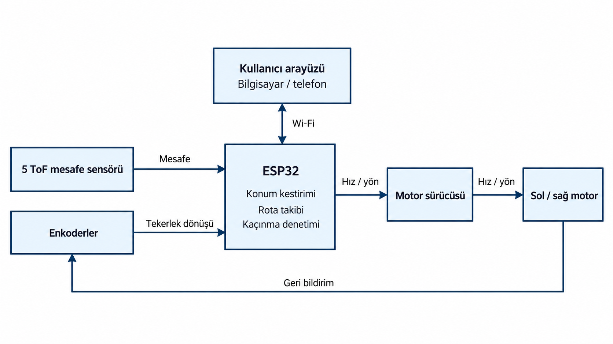
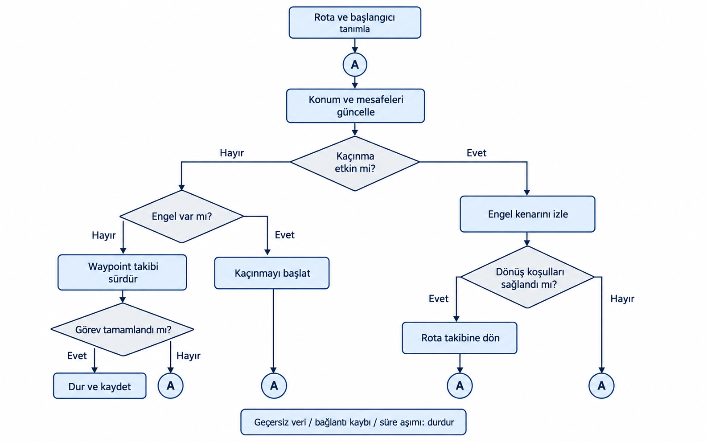
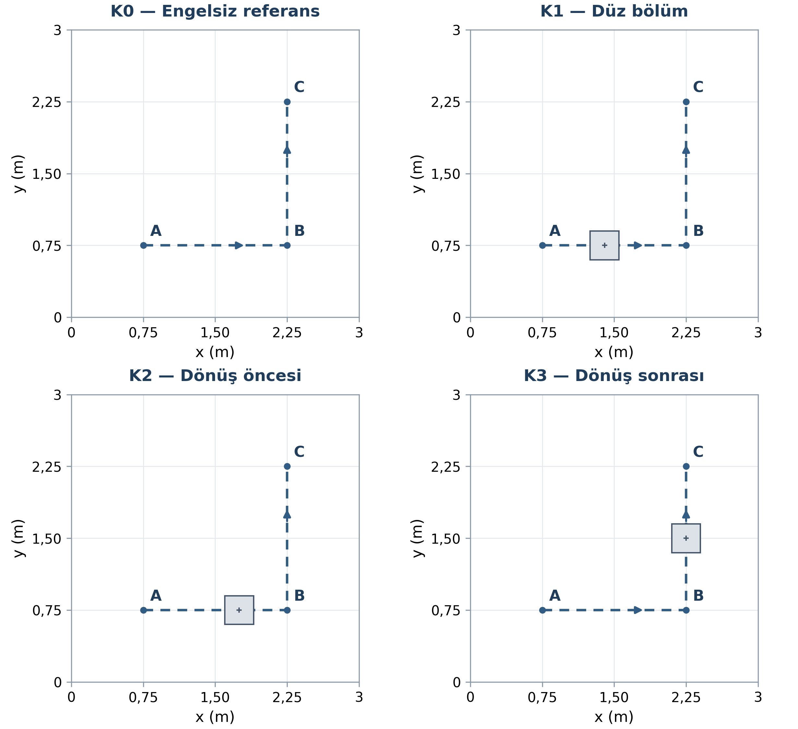
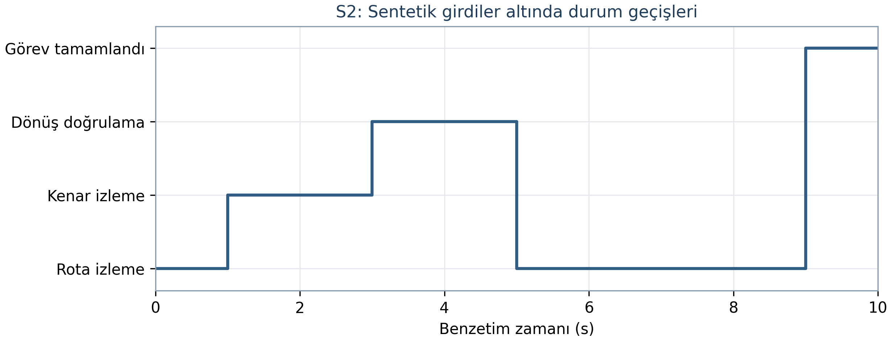

# TÜBİTAK 2209-A

**ÜNİVERSİTE ÖĞRENCİLERİ ARAŞTIRMA PROJELERİ DESTEKLEME PROGRAMI**

**ARAŞTIRMA ÖNERİSİ**

**Kullanıcı tanımlı rotada sabit engelden kaçınma ve rotaya yeniden katılma: küçük ölçekli bir kara aracında deneysel değerlendirme**

**Proje yürütücüsü**  
Ahmet Talha Arslan

**Akademik danışman**  
Prof. Dr. Murat Ceylan

**Konya Teknik Üniversitesi**  
Elektrik-Elektronik Mühendisliği

**2026 YILI**

<!-- KAPAK SONU -->

## A. GENEL BİLGİLER

| Alan | Bilgi |
| --- | --- |
| Başvuru sahibinin adı soyadı | Ahmet Talha Arslan |
| Araştırma önerisinin başlığı | Kullanıcı tanımlı rotada sabit engelden kaçınma ve rotaya yeniden katılma: küçük ölçekli bir kara aracında deneysel değerlendirme |
| Akademik danışman | Prof. Dr. Murat Ceylan |
| Üniversite / bölüm | Konya Teknik Üniversitesi / Elektrik-Elektronik Mühendisliği |
| Öğrenim düzeyi | Lisans, 4. sınıf |
| Proje ekibi | Bir öğrenci yürütücü |
| Proje süresi | 6 ay |
| Talep edilen destek | 11.500 TL; KDV dahil tahmini bütçe |

## ÖZET

::: {.ozet}

Bu araştırmada, kullanıcı tarafından tanımlanan rotayı izleyen, sabit engelleri algılayıp çarpışmadan kaçınarak rotasına dönen küçük ölçekli bir otonom kara aracı geliştirilecektir. Araştırmanın temel sorusu, aynı rota üzerindeki farklı engel yerleşimlerinin algılama, kaçınma, rotaya dönüş ve görev tamamlama başarısını nasıl etkilediğidir.

Sistem; kablosuz haberleşmeli bir mikrodenetleyici, bağımsız sürülen iki enkoderli motor ve beş sabit uçuş süresi (ToF) mesafe sensöründen oluşacaktır. Bilgisayar öncelikli, telefondan da erişilebilir web arayüzünde yerel koordinatlarla sıralı ara rota noktaları (waypoint) tanımlanacaktır. Enkoder tabanlı konum kestirimi ve mesafe ölçümleriyle hareket kontrol edilecek; engelden kaçınma ve rotaya yeniden katılma, Bug 2 yaklaşımından yararlanan bir durum makinesiyle gerçekleştirilecektir.

Düz zeminde 3 × 3 metrelik kontrollü alanda, engelsiz referans ve üç sabit engel yerleşimi değerlendirilecektir. Her koşulda 10 tekrar olmak üzere toplam 40 geçerli deneme yapılacaktır. Her engelli koşulda en az 8/10 denemede temas öncesi algılama, çarpışmasız kaçınma, rotaya dönüş ve hedefe ulaşmanın birlikte sağlanması hedeflenmektedir. Waypoint erişimi ve rotaya dönüş için 10 cm tolerans, görev tamamlama için 120 saniye üst sınırı kullanılacaktır. Hareket, mevcut telefonla alınacak sabit görüntü kaydı üzerinden bağımsız olarak değerlendirilecektir. Başarı oranları güven aralıklarıyla, tamamlanma süreleri ve rota izleme hatalarıyla birlikte raporlanacaktır. Ön çalışmada altı sentetik senaryoyla durum makinesinin geçiş ve durdurma mantığı kontrol edilmiştir.

Altı aylık çalışma, donanım ve kalibrasyon, arayüz, rota takibi, engelden kaçınma ile deney, analiz ve raporlamadan oluşan dört iş paketinde yürütülecektir. Beklenen çıktılar bir araç prototipi, rota arayüzü, deney kayıt kümesi ve sürümlenmiş yazılım ile teknik dokümantasyondur. Çalışmanın, gömülü kontrol ve mobil robotik alanında deneysel bir eğitim ve geliştirme altyapısı oluşturması beklenmektedir.

**Anahtar kelimeler:** Otonom kara aracı, rota takibi, engelden kaçınma, enkoder, gömülü kontrol.

:::

## 1. ARAŞTIRMA ÖNERİSİNİN BİLİMSEL NİTELİĞİ

### 1.1. Konunun önemi ve araştırma önerisinin bilimsel niteliği

**Konunun önemi ve ele alınan problem**

Kullanıcının bir arayüzde çizdiği rotanın gerçek bir araç tarafından izlenebilmesi için konum hesabı, motor kontrolü ve çevrenin algılanması birlikte çalışmalıdır. Araç rota üzerinde bir engelle karşılaştığında yalnızca durması görevi tamamlamaya yetmez. Engeli algılayıp uygun bir yönden dolaşması ve kullanıcı tarafından belirlenen rota üzerindeki görevine devam etmesi gerekir. Bu proje, söz konusu davranışı küçük ölçekli bir kara aracı üzerinde geliştirmeye ve kontrollü deneylerle değerlendirmeye odaklanmaktadır.

İki tekerleği bağımsız sürülen araçlarda, tekerlek hareketleri kullanılarak aracın doğrusal hareketi ve yönelimi hesaplanabilir (Corke, 2017). Bununla birlikte tekerlek kayması ve dönüşlerdeki hatalar konum hesabını etkileyebilir. Yerel mesafe bilgisiyle çalışan Bug türü yöntemler ise tüm engellerin haritası önceden bilinmeden hedefe ilerleme ve engel çevresini izleme davranışlarını ele almaktadır. Bu yöntemlerin fiziksel bir araçta uygulanmasında araç boyutu, algılama kapsamı ve konum hatası dikkate alınmalıdır (Lumelsky ve Stepanov, 1987; Corke, 2017).

Örneğin, depo veya lojistik alanında tanımlı bir rota boyunca yük taşıması planlanan küçük bir araçta, sabit engel sonrasında göreve devam etme davranışı bir uygulama senaryosu olarak ele alınabilir. Bu çalışma, aynı problemi küçük ölçekli bir prototipte ele alarak gömülü kontrol ve mobil robotik eğitiminde kullanılabilecek, deneyleri tekrarlanabilir bir platform oluşturmayı hedeflemektedir. Elde edilecek bulgular, kontrollü derslik koşulları için yorumlanacaktır.

**İlgili çalışmalar ve projenin yaklaşımı**

Alajlan vd. (2017), farklı sensörlerden gelen bilgiyi birleştirerek mobil bir robotun engelli ortamdaki hareketini incelemiştir. Bu çalışma, engel algılama ile hareket kararlarının birlikte tasarlanması açısından yol göstericidir. Önerilen projede beş sabit mesafe sensörüyle sabit engeller üzerinde çalışılacaktır. Telefon kamerası ise aracın engel algılayıcısı olarak değil, deneylerde hareketi bağımsız ölçmek için kullanılacaktır.

Iqbal vd. (2023), koordinatların bir uygulamadan kablosuz bağlantılı mobil robota aktarılmasını içeren bir sistem sunmuştur. Rodrigues vd. (2026), enkoderler, dış kamera temelli konum bilgisi ve gömülü kontrol katmanını içeren küçük bir robotta yörünge takibini değerlendirmiştir. Bu çalışmalar, rota bilgisinin aktarılması ve hareket kontrolünün kurulması için örnek oluşturmaktadır. Bu projede ise arayüzden verilen rota, enkoder tabanlı konum hesabı ve yerel engel algılama bir araya getirilecek; engelden sonra aynı rotaya dönme davranışı incelenecektir.

**Araştırma boşluğu**

İncelenen uygulamalarda koordinat aktarımı ve zemin işaretleme (Iqbal vd., 2023), diferansiyel sürüşlü araçta yörünge takibi (Rodrigues vd., 2026) ve çoklu sensörle engelden kaçınma (Alajlan vd., 2017) farklı görevler ve deney düzenleri üzerinden değerlendirilmektedir. Bu projenin ele aldığı araştırma boşluğu, seçilen küçük ölçekli mimaride kullanıcı tanımlı rotaya engel sonrasında yeniden katılmanın hangi aşamalarda aksadığını ve engelin yerinin bu davranışı nasıl etkilediğini açıklayan deneysel veriye duyulan ihtiyaçtır. Bu amaçla algılama, kaçınma, dönüş ve görev tamamlama aynı protokolde ayrı kaydedilecek; sonuçlar bağımsız video ölçümü ve koşul başına tekrarlı denemelerle ilişkilendirilecektir. Böylece genel görev başarısının yanında, başarısızlığın oluştuğu aşamayı gösteren bir değerlendirme sağlanacaktır.

**Araştırma sorusu ve beklenen katkı**

Araştırma sorusu, “Sabit engelin rota üzerindeki yeri, kullanıcı tanımlı waypoint rotasını izleyen bir kara aracının engeli algılama, çarpışmadan kaçınma ve rotaya yeniden katılma başarısını nasıl etkiler?” biçiminde belirlenmiştir. Aynı araç ve rota kullanılarak engelin düz bölümde, dönüş öncesinde ve dönüş sonrasında bulunması karşılaştırılacaktır. Engelsiz koşul, temel rota takibini değerlendirmek için referans alınacaktır.

**Hipotez H1:** Planlanan geometride engelin rota üzerindeki uzak kenarı ile sıradaki waypoint arasındaki mesafe K1'de 0,70 m, K2'de 0,35 m ve K3'te 0,60 m'dir. Köşe waypoint'ine yaklaşımı temsil eden K2'de kullanılabilir mesafenin daha sınırlı olması nedeniyle birleşik görev başarı oranının K1 ve K3 koşullarından düşük olması beklenmektedir. Hipotez, koşul bazlı gözlenen oranlar ve güven aralıklarıyla değerlendirilecek; sınırlı tekrar sayısıyla kesin bir genelleme yapılmayacaktır.

Beklenen katkı, kullanıcı arayüzü ile gömülü hareket kontrolünü bütünleştiren bir prototipin geliştirilmesi ve başarının tek bir genel oran yerine algılama, kaçınma, rotaya dönüş ve görev tamamlama aşamalarında değerlendirilmesidir. Başarılı ve başarısız denemelerin birlikte incelenmesi, sistemin hangi koşullarda yeterli olduğunu ve hangi noktalarda geliştirme gerektirdiğini gösterecektir. Enkoder tabanlı konumda sistematik ve sistematik olmayan hata kaynaklarının ayrılması, kalibrasyon ile bağımsız değerlendirmeyi birlikte gerektirmektedir (Borenstein ve Feng, 1996). Çalışmanın sonuçları, düz zemindeki 3 × 3 metrelik alan ve seçilen sabit engel koşullarıyla sınırlandırılacaktır.

### 1.2. Amaç ve hedefler

Projenin amacı, kullanıcı tarafından belirlenen waypoint rotasını izleyen küçük ölçekli bir kara aracında sabit engelin temas öncesinde algılanmasını, çarpışmasız kaçınma hareketinin gerçekleştirilmesini ve aynı rotaya yeniden katılarak görevin sürdürülmesini sağlayan bir prototip geliştirmektir. Bu bütünleşik davranışın başarısı, engel yerleşiminin değiştirildiği kontrollü ve tekrarlı deneylerle değerlendirilecektir.

Bu amaca yönelik hedefler şunlardır:

1. Yerel koordinatlarla sıralı rota tanımlama, rotayı araca aktarma, başlatma/durdurma ve görev durumunu izleme işlevlerini bilgisayar ve telefon tarayıcısında sunan bir arayüz geliştirmek.
2. İki enkoderli motor, beş sabit ToF sensörü ve mikrodenetleyiciyi bütünleştirmek; tekerlek hareketi, dönüş, sensör kapsaması ve durma davranışı için kalibrasyon kayıtları oluşturmak.
3. Engel algılama, engel kenarını izleme ve rotaya dönüş davranışlarını durum/geçiş kurallarıyla gerçekleştirmek; waypoint sırasını kaçınma boyunca korumak.
4. Engelsiz referans ve üç sabit engel yerleşiminde koşul başına 10, toplam 40 geçerli değerlendirme denemesi yürütmek.
5. Her engelli koşulda en az 8/10 denemede temas öncesi algılama, çarpışmasız kaçınma, rotaya dönüş ve sıralı hedeflere erişimi 120 saniye içinde birlikte sağlamak. Waypoint erişiminde ve rotaya dönüşte 10 cm tolerans kullanmak.
6. Başarılı ve başarısız denemeleri birlikte raporlamak; aşama bazlı başarı oranları, tamamlanma süreleri ve bağımsız görüntü ölçümünden elde edilen rota hatalarıyla engel yerleşimlerinin etkisini açıklamak.

Bu sayısal değerler araştırmanın başarı hedefleridir; çalışma sonunda ölçülecek performansı tanımlar.

## 2. YÖNTEM

### 2.1. Araştırma tasarımı ve iş paketleriyle ilişki

Araştırma, prototip geliştirme ve kontrollü koşullarda tekrarlı deney tasarımına dayanmaktadır. Temel bağımsız değişken, aynı referans rota üzerindeki sabit engelin yerleşimidir. Bağımlı değişkenler; temas öncesi algılama, çarpışmasız kaçınma, rotaya dönüş ve görev tamamlama sonuçları ile süre ve rota izleme hatasıdır. Engel sayısı, boyutu ve yüzeyi engelli koşullar arasında sabit tutulacaktır. Başlangıç konumu/yönü, rota, zemin, hız ayarları ve son yazılım sürümü koşullar arasında değiştirilmeyecektir. Pil gerilimi, aydınlatma ve kontrol edilemeyen değişimler kaydedilecektir.

Donanım, kalibrasyon, arayüz ve haberleşme İP1; konum kestirimi ve rota takibi İP2; kaçınma ve rotaya dönüş İP3 kapsamında geliştirilecektir. Bütünleşik sistemin dört koşulda değerlendirilmesi, veri analizi ve sonuçların raporlanması İP4 kapsamında yapılacaktır. Geliştirme/ayar denemeleri, nihai 40 değerlendirme denemesinden ayrı tutulacaktır.

### 2.2. Donanım mimarisi ve bileşen gereksinimleri

Araç, iki tahrik tekerinin bağımsız sürüldüğü ve bir serbest tekerlekle desteklendiği diferansiyel sürüş düzeninde kurulacaktır. Başlangıç mekanik tasarımında gövde zarfı en çok 25 × 20 cm olacak; tekerlekler, sensörler ve bağlantılar dahil gerçek dış ölçüler kaydedilecektir. Araç referans noktası, iki tahrik tekeri arasındaki aksın orta noktası olarak tanımlanacaktır.

Kontrol birimi için ESP32 ailesinden bir mikrodenetleyici kullanılacaktır. Bu birim enkoderleri okuyacak, mesafe ölçümlerini işleyecek, hareket kararlarını verecek ve motorları sürecektir. Satın alınacak kart, sensör taşıyıcısı ve mekanik parçalar aşağıdaki işlevsel gereksinimlere göre seçilecektir; literatürdeki referans bileşen belirli bir taşıyıcı ürünün satın alınma şartı değildir.

| Bileşen | Miktar | Teknik gereksinim ve kullanım |
| --- | --- | --- |
| Kablosuz haberleşmeli kontrol kartı | 1 | Wi-Fi, 3,3 V sayısal arayüzler, enkoder okumaya ve iki motorun bağımsız hız/yön kontrolüne yeterli giriş/çıkış. |
| Enkoderli DC motor | 2 | Aynı model, redüktörlü; 5 V motor beslemesinde 0,10 m/s araç hızını sağlayan tork/hız ve 3,3 V uyumlu ya da seviyelendirilmiş A/B geri bildirim çıkışları. |
| Çift kanallı motor sürücü düzeni | 1 takım | 3,3 V kontrol uyumu; her kanalın sürekli ve kısa süreli akım kapasitesinin motorun yük ve kalkış/sıkışma gereksinimlerini karşılaması. |
| Sabit ToF mesafe sensörü | 5 | Ön orta, iki ön çapraz ve iki yan yerleşim; 3,3 V uyumlu taşıyıcı arayüzü; beşli taramayı 200 ms içinde tamamlayan ölçüm düzeni ve geçersiz ölçüm bilgisinin okunması. |
| I²C çoklayıcı | 1 | Beş sensörü ayrı kanallardan seçerek okumaya uygun, en az beş kanallı ve 3,3 V mantık uyumlu düzen. |
| Güç altyapısı | 1 takım | Hazır 2S batarya, kimyası ve bağlantılarıyla uyumlu şarj cihazı, paket koruması, 5 V ve 3,3 V düzenlenmiş besleme dalları. |

Sensörlerin başlangıç yönleri ileri eksene göre 0°, ±45° ve ±90° olacaktır. Ön sensörler yaklaşan engeli, yan sensörler engel kenarındaki açıklığı izleyecektir. Montaj yüksekliği, ışınların deney engelini göreceği biçimde ayarlanacak; gerçek kapsama ve kör bölgeler kalibrasyon kaydına işlenecektir. Beş sensörün varlığı kesintisiz çevre algısı olarak yorumlanmayacaktır.

ToF ölçümünün geçerliliği; hedef yüzeyi, ortam ışığı ve ölçüm süresine bağlı olarak kontrol edilecektir. Referans ToF bileşeninin veri sayfası, farklı yansıtıcılık ve aydınlatma koşulları için ayrı menzil ve doğruluk değerleri vermektedir (STMicroelectronics, 2024). Bu nedenle üretici tablosundaki bir değer doğrudan aracın doğruluğu kabul edilmeyecek; seçilen taşıyıcı ve deney engeli için tekrarlı mesafe kontrolleri yapılacaktır.

Motorlar ve kontrol elektroniği ayrı güç kablo dallarından beslenecek, ortak toprak referansı kullanılacaktır. Bataryanın ham gerilimi motorlara veya kontrol kartı giriş/çıkışlarına uygulanmayacaktır. Motor sürücüsü, regülatör, kablo ve koruma elemanları iki motorun birlikte kalkış/yük akımı esas alınarak boyutlandırılacaktır. Ürünlerin gerilim, akım, bağlantı ve şarj uyumu, montajın giriş kontrolünde veri sayfaları ve elektriksel kontrollerle doğrulanacaktır.

**Şekil 1.** Kullanıcı arayüzü, algılama, mikrodenetleyici ve motor sürme birimleri arasındaki veri akışı. ÜYZ desteğiyle hazırlanmış işlevsel tasarım şemasıdır.

### 2.3. Konum kestirimi ve rota takibi

Tekerlek yarıçapları, iki tekerlek arasındaki açıklık ve çıkış mili devri başına sayılan enkoder kenarı sayısı kalibrasyonla kaydedilecektir. Motor mili/çıkış mili çözünürlüğü ve sayım yöntemi birbirinden ayrılacaktır. Diferansiyel sürüş kinematiğiyle tekerlek hareketlerinden göreli konum ve yön hesaplanacaktır (Corke, 2017). Tekerlek çapı ve aks açıklığı kaynaklı sistematik hatalar, düz ilerleme ve alan içine sığan saat yönü/saat yönü tersi kapalı yol tekrarlarıyla incelenecek; kayma gibi sistematik olmayan etkiler ayrıca kaydedilecektir (Borenstein ve Feng, 1996).

$$\Delta s=\frac{\Delta s_R+\Delta s_L}{2},\qquad \Delta\theta=\frac{\Delta s_R-\Delta s_L}{b}$$

Burada $\Delta s_R$ ve $\Delta s_L$ sağ ve sol tekerleğin katettiği yolları; $b$ tekerlekler arası açıklığı gösterir. Konum, her adımda orta yönelim kullanılarak güncellenecektir. Başlangıç konumu ve yönü işaretli alan üzerinde ayarlanacak, her denemede enkoder başlangıç değerleri kaydedilecektir.

Sıradaki waypoint'e yönelim hatası üzerinden açısal hız komutu üretilecek; hedefe yaklaşırken doğrusal hız azaltılacaktır. Motor hızları enkoder geri bildirimiyle ayrı ayrı kapalı çevrim kontrol edilecektir. Köşe waypoint'inde erişim doğrulandıktan sonra sonraki parçaya yönelinecek; kaçınma sırasında etkin hedef ve yüklenen sıra korunacaktır. Nominal düz ilerleme hızı 0,10 m/s, kaçınma ilerleme hızı en çok 0,05 m/s olarak planlanmıştır. Yerinde yönelme hareketlerinde gövdenin taradığı alan dikkate alınacaktır.

Denetim döngüsü 20 Hz, beş sensörün tam taraması en az 5 Hz ve görev telemetrisi 5 Hz olacak şekilde planlanmıştır. Sensör başına yaklaşık 33 ms ölçüm bütçesinde beşli tarama 165 ms tutacak; kanal seçimi ve veri işleme için 35 ms ayrılarak toplam tarama hedefi 200 ms olacaktır. Referans bileşende belirtilen 33 ms ölçüm bütçesi bu başlangıç planına dayanak oluşturmaktadır (STMicroelectronics, 2024). 250 ms veri yaşı sınırı, 200 ms taramaya 20 Hz denetimin bir periyodu olan 50 ms'nin eklenmesiyle belirlenmiştir. Bunlar ölçülmüş gecikmeler değil, zamanlama tasarım hedefleridir. Ölçüm başlangıcı zaman damgalanacak; veri yaşı her denetim adımında kontrol edilecektir. Eşik aşımı en geç sonraki 50 ms'lik adımda durdurmaya dönüşeceğinden, durma mesafesi hesabında 300 ms'lik toplam veri yaşı/tepki bütçesi dikkate alınacaktır.

Sensörler ayrı kanallardan sıralı okunacaktır. Tamamlanan her sensör ölçümü, tam taramanın sonunu beklemeden denetleyiciye ayrı olarak aktarılacaktır. Üretici durum kodlarına göre ölçüm sonucu ve iletişim/ölçüm hatası ayrılacak; belirsiz veri boş yol kabul edilmeyecektir. Gerçek tarama ve tepki süreleri montaj sonrasında kaydedilecek; 200 ms tarama hedefi sağlanmadan nihai deneylere başlanmayacaktır. Hedef aşılırsa ölçüm alma ve veri aktarımı denetimi bloke etmeyen görevlerle düzenlenecek; üreticinin izin verdiği daha kısa ölçüm bütçesi, engel yüzeyindeki ölçüm geçerliliği yeniden sınanarak kullanılacaktır. Gerektiğinde aynı beşli düzeni ve zamanlama hedefini karşılayan eşdeğer bir ToF taşıyıcısı seçilecektir. Azalan ölçüm süresinin belirsizliği artırması halinde araç hızı da düşürülecek; bu işlem tek başına tarama süresini kısaltan bir çözüm sayılmayacaktır. Beş sensör, 250 ms veri yaşı sınırı ve 120 saniye görev hedefi korunacak; nihai parametreler tüm koşullar için deneylerden önce sabitlenecektir. Tekerlek kayması ve odometrik sürüklenme bağımsız ölçümle izlenecektir.

### 2.4. Kullanıcı arayüzü ve haberleşme

Arayüz HTML, CSS ve JavaScript ile hazırlanacak; kontrol kartının oluşturacağı yerel kablosuz ağ üzerinden bilgisayar ve telefon tarayıcısında açılacaktır. Kullanıcı, metre ölçekli kareli alan üzerinde başlangıç konumu/yönünü ve waypoint'leri sıralı belirleyecektir. Koordinatların yerel olması, çizilen rotanın deney alanıyla doğrudan ilişkilendirilmesini sağlayacaktır.

Rota HTTP üzerinden araca aktarılacak; görev durumu ve komutlar WebSocket bağlantısıyla iletilecektir. Alan dışındaki noktalar ve sıfır uzunluklu ardışık parçalar yükleme sırasında reddedilecektir. Başlatma için rota kabulü, geçerli sensör verisi ve uygun besleme durumu aranacaktır.

Arayüzde tahmini konum, etkin waypoint, mesafe ölçümleri, görev durumu ve hata nedeni gösterilecektir. Hareket kararları araç üzerinde verilecek; kullanıcı rota yüklendikten sonra aracı elle yönlendirmeyecektir. Arayüz 0,5 saniyede bir bağlantı canlılık mesajı gönderecek; 1 saniye boyunca bu mesaj alınamazsa motorlar durdurulacaktır. Durdurma komutu veya hata sonrasında hareket, kendiliğinden yeniden başlamayacaktır. Şasi üzerindeki erişilebilir ana güç anahtarı, gerektiğinde motor beslemesini fiziksel olarak kesmek için kullanılacaktır.

### 2.5. Engel algılama, kaçınma ve rotaya dönüş

Kaçınma, Bug 2 yaklaşımının engel kenarını izleme ve hedef doğrultusuna yeniden katılma mantığından yararlanan bir durum makinesiyle gerçekleştirilecektir (Lumelsky ve Stepanov, 1987; Corke, 2017). Temel durumlar bekleme, rota izleme, engel yaklaşımı/durma, kenar izleme, rotaya dönüş doğrulama, görev tamamlandı ve hata/durdurma olacaktır.

Engel algılama eşiği, sensörün araç gövdesine göre ofseti, 300 ms veri yaşı/tepki bütçesinde alınan yol, ölçülen durma mesafesi ve 5 cm açıklık payından türetilecektir. Gövde ön sınırı esas alındığında eşik en az 20 cm olacaktır; kalibrasyon daha büyük mesafe gerektirirse artırılacaktır. Böylece sensörün bildirdiği uzaklık doğrudan gövde açıklığı sayılmayacaktır. Bu ayar tüm nihai deneylerde sabit tutulacaktır.

Engel algılandığında araç yavaşlayıp duracak; kaçınmaya başlama konumu ile etkin hedefe uzaklık kaydedilecektir. Araç başlangıçta sağa yönelip engeli solunda tutarak kenar izleyecektir. Sol yan mesafe ölçümüyle gövde–engel açıklığı için 10 cm nominal değer izlenecek; ön ve çapraz ölçümler dönüş kararlarında kullanılacaktır. Kontrol, sensör ofsetleri ve gövdenin tamamı için geçiş açıklığını dikkate alacaktır. Kör bölgeye doğrulanmamış geri hareket komutu verilmeyecektir.

Rotaya yeniden katılma için aşağıdaki koşullar birlikte aranacaktır:

1. Araç referans noktasının etkin **sonlu rota parçasına** uzaklığı en çok 10 cm olmalıdır.
2. Etkin hedefe uzaklık, kaçınma başlangıcına göre en az 10 cm ve konum belirsizliğini aşan miktarda azalmış olmalıdır.
3. Engel geride kalmalı ve aracın tüm gövdesi için ilerleme açıklığı bulunmalıdır.
4. Araç dönüş bandında en az 1 saniye kalmalı ve aynı hedef yönünde en az 10 cm ilerlemelidir. Sıradaki waypoint'e erişim bu süreçte gerçekleşirse hedef değişimi dönüş doğrulamasından sonra yapılmalıdır.

İdeal Bug 2 algoritmasının tamlık özellikleri bu fiziksel uyarlama için garanti edilmeyecektir. Kaçınma başlangıç bölgesinden en az 20 cm uzaklaştıktan sonra bu konumun 10 cm çevresine hedefe ilerleme sağlayamadan geri dönme, döngü şüphesi olarak kaydedilecektir. Geçersiz sensör verisi, haberleşme kaybı ve 120 saniye süre aşımı araç üzerinde durdurma üretecektir. Deney gözlemcisi fiziksel temas veya alan sınırı ihlali görürse arayüzden ya da ana güç anahtarından denemeyi durduracak; bu müdahale başarısız deneme olarak kaydedilecektir. Ayrı bir temas sensörüyle otomatik çarpışma algılama iddia edilmemektedir. Durdurma nedeni, deney sonucu ve günlük kaydıyla ilişkilendirilecektir; döngü kaydı ortamda hiçbir geçerli yol bulunmadığı biçiminde yorumlanmayacaktır.

**Şekil 2.** Rota izleme, engel algılama, kaçınma ve rotaya dönüş durumları arasındaki kontrol akışı. “A” bağlantıları kontrol döngüsüne dönüşü gösterir. ÜYZ desteğiyle hazırlanmış tasarım şemasıdır.

### 2.6. Deney alanı, koşullar ve uygulama sırası

Konya Teknik Üniversitesi Elektrik-Elektronik Mühendisliği Bölümünde derslik kullanımı için bölümden teyit alınmıştır. Deneylerin bu derslikte kurulacak, düz ve kuru zeminli 3 × 3 metrelik kontrollü alanda yürütülmesi planlanmaktadır. Bir köşe yerel koordinat sisteminin başlangıcı olacak; metre birimindeki rota **A=(0,75; 0,75), B=(2,25; 0,75), C=(2,25; 2,25)** şeklinde kurulacaktır. Noktalı virgül x ve y bileşenlerini ayırmaktadır. Toplam referans rota uzunluğu 3,00 metredir. Başlangıç yönü A'dan B'ye doğru olacaktır.

Engelli koşullarda aynı 30 × 30 cm tabanlı, 30 cm yüksekliğinde, opak ve mat yüzeyli tek prizmatik engel kullanılacaktır. Tüm koordinatlar araç referans noktası ve engel merkezi esas alınarak işaretlenecektir.

| Koşul | Engel merkezi (m) | İncelenen durum | Tekrar |
| --- | --- | --- | --- |
| K0 | Engel yok | Engelsiz rota takibi ve yanlış engel uyarıları | 10 |
| K1 | (1,40; 0,75) | İlk düz bölümde kaçınma ve aynı parçaya dönüş | 10 |
| K2 | (1,75; 0,75) | Köşe waypoint'ine yaklaşırken kaçınma ve dönüş | 10 |
| K3 | (2,25; 1,50) | Köşeden sonraki parçada kaçınma ve dönüş | 10 |

Geometri, araç gövdesi ve dönüşte taranan alanla birlikte kurulum aşamasında kontrol edilecektir. Nihai deneylere başlamadan önce engelin waypoint'leri kapatmadığı ve kaçış yönünde serbest geçiş bulunduğu doğrulanacaktır. Bu kontrol, deney sırasında koşul değiştirmek için kullanılmayacaktır.

Toplam 40 geçerli deneme, her blokta K0–K3 birer kez bulunacak şekilde 10 blokta uygulanacaktır. Blok içi sıra, önceden kaydedilen sabit bir rastgeleleştirme tohumu kullanılarak üretilecek ve deney kayıtlarıyla saklanacaktır. Her denemede başlangıç pozu yeniden kurulacak; batarya üreticisinin çalışma aralığı ve yük altındaki besleme kontrolü sağlanmadan görev başlatılmayacaktır. Koşullar son yazılım sürümü ve aynı parametrelerle karşılaştırılacaktır.

**Şekil 3.** Planlanan dört deney koşulunun koordinatlara göre çizilmiş geometrisi. Kesikli çizgi A–B–C referans rotasını; gri kare, 30 × 30 cm tabanlı engeli gösterir. Koordinatlar Bölüm 2.6 ile aynıdır. Bu çizim planlanan düzeneği gösterir; deney veya simülasyon sonucu değildir.

### 2.7. Bağımsız ölçüm ve başarı ölçütleri

Aracın hareketi, yürütücünün mevcut telefonuyla en az 1080p ve 30 kare/saniye sabit görüntü kaydına alınacaktır. Başlangıç montaj yüksekliği yaklaşık 3,0 m olarak planlanmakta; bu değerin tek başına yeterli görüş alanı sağladığı varsayılmamaktadır. Dersliğin tavan yüksekliği ve kullanılabilir sabitleme noktası ölçülecek, alan merkezine yönelmiş kamerada 3 × 3 metrelik alanın çevresinde görüntü payı bırakılacaktır. Alan sığmazsa, mevcut telefonda bulunması halinde geniş açı modu ve bozulma düzeltmesi kullanılacak; bu seçenek yoksa veya doğruluk hedefini karşılamazsa güvenli montaj yüksekliği/konumu değiştirilecek ya da aynı boyuttaki alan daha uygun tavan ve sabitleme olanağı bulunan başka bir kapalı mekâna taşınacaktır. Alan küçültülmeyecek; seçilen mercek modu, gerçek montaj yüksekliği ve kontrol noktası hataları kaydedilecektir. Kamera konum bilgisi araç denetleyicisine verilmeyecek; bağımsız değerlendirme için kullanılacaktır.

Görüntü–metre dönüşümü, ölçülmüş konumdaki en az altı referans noktayla kurulacak; dönüşümde kullanılmayan ve alanı kapsayan en az beş kontrol noktasıyla sınanacaktır. İç kamera parametreleri ve mercek bozulması, farklı açılardan alınan düzlemsel kalibrasyon örüntüsü görüntüleriyle kestirilecektir (Zhang, 2000). Araç üzerindeki işaretin yüksekliğinden kaynaklanan perspektif hatası da düzeltilecektir. İzleme işareti aks orta noktasının üstüne yerleştirilecek; görüntü dönüşümünde işaretin bulunduğu yükseklik düzlemi esas alınacaktır. Kontrol noktalarında en çok 2 cm konum hatası çalışma hedefi olarak kullanılacak, ölçülen kalibrasyon hatası ve dinamik izlemenin ek belirsizlikleri ayrıca raporlanacaktır. Kalibrasyonda kullanılan noktalarla bağımsız kontrol noktaları ayrı tutulacak; mercek modu ve montaj değişirse kalibrasyon tekrarlanacaktır.

Araç günlüğü ve video, görüntüde görülen ve günlükte zaman damgası bulunan ortak bir ışık olayıyla başlangıç ve bitişte eşlenecektir. Zaman eşleme hatası kaydedilecek; temas ile algılama sırası bu belirsizlik içinde ayırt edilemiyorsa temas öncesi başarılı algılama sayılmayacaktır. Konum, geçerli kayıt bölümlerinden 10 Hz eşit zaman aralığıyla örneklenecektir. Kayıp görüntü aralıkları ve değerlendirilebilen süre açıkça verilecektir.

| Ölçüt | Başarı kuralı | Kayıt / değerlendirme |
| --- | --- | --- |
| Temas öncesi algılama | Engel olayının ilk fiziksel temastan önce oluşması | Zaman eşlenmiş sensör günlüğü ve video |
| Çarpışmasız kaçınma | Gövde ve tekerlekler temas etmeden engelin geride bırakılması | Bağımsız video ve gövde açıklığı |
| Waypoint erişimi | Sıradaki noktaya uzaklık en çok 10 cm | Görüntüden sıralı erişim; ölçüm belirsizliği dikkate alınır |
| Rotaya dönüş | Sonlu parçaya en çok 10 cm uzaklık; Bölüm 2.5'teki açıklık, süre ve ilerleme koşulları | Bağımsız konum ve video |
| Görev tamamlama | Sıralı waypoint'lerden sonra son hedef bandında 2 saniye durma; toplam süre en çok 120 saniye | Süre hareketin başlamasından durma doğrulamasının bitimine kadar |
| Birleşik görev başarısı | K1, K2 ve K3'ün her birinde en az 8/10 denemede tüm aşamaların birlikte sağlanması | Her koşul ayrı değerlendirilir |

Waypoint ve rotaya dönüş için 10 cm, tüm hareket boyunca sağlanmış bir izleme hatası olarak yorumlanmayacaktır. Bir uzaklığın 10 cm sınırını karşıladığına ilişkin başarı kararı, ölçülen uzaklık ile ilgili konum belirsizliği toplamının bu sınırı aşmamasıyla verilecektir. Eşik çevresinde belirsiz kalan olaylar ayrı işaretlenecek ve başarılı sayılmayacaktır. Yalnızca engel önünde durmak veya elle yönlendirilerek devam etmek otonom başarı kabul edilmeyecektir.

### 2.8. Veri analizi ve başarısız denemelerin değerlendirilmesi

Algılama, kaçınma, rotaya dönüş ve görev tamamlama oranları her koşulda ayrı hesaplanacaktır. Payda, ilgili koşuldaki tüm geçerli denemeler olacaktır; sonraki aşamaya ulaşamayan denemeler bu aşamanın paydasından çıkarılmayacaktır. Engelsiz koşulda engel aşamaları uygulanmaz olarak kaydedilecek; görev başarısı ve yanlış engel uyarıları raporlanacaktır.

Her başarı oranı, başarılı deneme sayısı/geçerli deneme sayısı ve yüzdeyle birlikte %95 Wilson skor güven aralığıyla verilecektir (Wilson, 1927). Bu aralıklar, koşul içindeki denemelerin Bernoulli modeliyle özetlenmesine dayanacak; aynı araçta tekrardan kaynaklanabilecek bağımlılık ve koşul başına 10 denemenin getirdiği belirsizlik yorumda belirtilecektir.

Tamamlanan görevlerin süreleri medyan ve en küçük–en büyük değerlerle özetlenecek; tamamlanamayan görevler, durdurma nedenleri ve süre aşımları ayrıca gösterilecektir. Her engelli koşul için en az 8/10 birleşik başarı hedefi ayrı sınanacaktır. Toplam engelli denemelerde 24/30 başarı elde edilmesi, tek başına koşul başına hedefin sağlandığını göstermeyecektir.

Rota hatası, aracın görüntüden ölçülen referans noktasının etkin sonlu rota parçasına en kısa uzaklığı olarak hesaplanacaktır. Etkin parça, waypoint'lere sıralı erişimin bağımsız doğrulanmasıyla seçilecektir. Parçanın sonsuz uzantısına uzaklık kullanılmayacaktır. Eşit aralıklarla örneklenen geçerli rota izleme verilerinden kök ortalama karesel hata hesaplanacaktır:

$$\operatorname{RMSE}=\sqrt{\frac{1}{N}\sum_{i=1}^{N}e_i^2}$$

Burada $e_i$ ilgili örnekteki sonlu parçaya uzaklığı, $N$ değerlendirilen örnek sayısını gösterir. Her deneme için RMSE, en büyük sapma ve veri kapsamı verilecek; kaçınmanın gerektirdiği geçici sapma ile normal rota takibi ve rotaya dönüş sonrası hata ayrı değerlendirilecektir. Kaçınma aralığı, engel olayından bağımsız olarak doğrulanan rotaya dönüşe kadar tanımlanacaktır.

Çarpışma, sınır dışına çıkma, denetleyici yeniden başlatması, bağlantı/sensör kaynaklı durdurma, döngü ve süre aşımı başarısız deneme olarak tutulacaktır. Yalnız araç davranışından bağımsız, sonucu değerlendirmeyi engelleyen video/harici kayıt hataları gerekçeleriyle geçersiz sayılabilecek ve aynı koşulda tekrar edilecektir. Araç başarısızlığı biliniyorsa eşzamanlı kayıt kaybı denemeyi dışlamak için kullanılmayacaktır. Başlatılan, geçersiz ve yerine yapılan deneme sayıları açıklanacaktır.

Ham sensör verileri, enkoderler, konum kestirimi, durum geçişleri ve video dosyaları ortak deneme kimliğiyle ilişkilendirilecektir. Yazılım/parametre değişikliği gerekirse eski kayıtlar korunacak ve karşılaştırılan koşullar yeni sürümle yeniden yürütülecektir. Kabul eşikleri sonuç görüldükten sonra gevşetilmeyecektir. Bulgular, dört koşul ve sınırlı tekrar sayısı içinde betimsel olarak yorumlanacak; tüm ortamlara genellenen başarı veya istatistiksel anlamlılık iddiası kurulmayacaktır.

### 2.9. Ön çalışma ve uygulanabilirlik

Durum makinesinin geçiş ve durdurma mantığı için 50 ms adımlı bir ayrık zaman benzetimi hazırlanmış ve çalıştırılmıştır. Altı sentetik senaryoda rota izleme, kaçınma, dönüş doğrulama ve hata nedeniyle durdurma davranışları kontrol edilmiştir. Girdiler kontrollü olarak üretilmiştir; araç kinematiği, tekerlek kayması ve ToF sensör fiziği bu ön çalışmada modellenmemiştir.

| Senaryo | Sınanan davranış | Çalıştırma sonucu |
| --- | --- | --- |
| S1 | Engelsiz görev ve hedefte 2 saniye durma | Beklenen tamamlanma geçişi sağlandı. |
| S2 | Engel, kenar izleme ve süre/ilerleme koşullarıyla dönüş | Dönüş 5. saniyede doğrulandı; sentetik görev 9. saniyede tamamlandı. |
| S3 | Hedefe ilerleme olmadan dönüş bandına girme | Rota takibine erken dönüş engellendi. |
| S4 | Güncellenmeyen sensör zaman damgası | 250 ms sınırının aşılmasını izleyen adımda durdurma üretildi. |
| S5 | Bir saniye canlılık mesajı alınamaması | Bağlantı kaybı nedeniyle durdurma üretildi. |
| S6 | Görevin 120 saniyeyi doldurması | Süre sınırında durdurma üretildi. |

Altı senaryodaki mantıksal kontroller beklenen sonuçları vermiştir. Şekil 4, S2 senaryosunun üretilen durum kaydını göstermektedir. Bu ön çalışma kontrol akışının uygulanabilirliğine ilişkin bir yazılım doğrulamasıdır; fiziksel araçta 8/10 görev başarısının veya 10 cm konum hedefinin sağlandığını göstermez. Fiziksel prototip, kalibrasyon ve bağımsız video deneyleri proje kapsamında gerçekleştirilecektir. Kaynak kod ve sentetik kayıtlar proje deposunda ön çalışma verisi olarak ayrı tutulmaktadır.

**Şekil 4.** Çalıştırılan S2 mantıksal benzetiminde elde edilen durum geçişleri. Engel ve konum koşulları sentetik girdilerdir; grafik fiziksel rota, sensör doğruluğu veya deneysel araç performansı göstermez.

## 3. PROJE YÖNETİMİ

### 3.1. Çalışma takvimi

Proje altı ayda yürütülecektir. Aylar, değerlendirme sonuçlarının ilanına göre başlayan proje süresini gösterir. Tüm iş paketlerinin uygulama sorumlusu Ahmet Talha Arslan'dır; akademik danışman Prof. Dr. Murat Ceylan bilimsel yönlendirme ve değerlendirme sağlayacaktır.

| Dönem | İş paketi / faaliyet | Sorumlu | Başarı ölçütü | Katkı |
| --- | --- | --- | --- | --- |
| 1–2. ay | İP1 — Donanım, kalibrasyon, arayüz ve haberleşme | Ahmet Talha Arslan | İki motor/enkoder ve beş sensörün çalışması; hareket, kapsama, durma ve kamera kalibrasyon kayıtları; rota aktarımı, telemetri ve bağlantı kaybında durdurmanın doğrulanması. | %35 |
| 3. ay | İP2 — Konum kestirimi ve rota takibi | Ahmet Talha Arslan | A–B–C waypoint sırasının engelsiz ayar denemelerinde izlenmesi; 10 cm erişim ölçütünün ve bağımsız konum kaydının kontrolü. | %20 |
| 4–5. ay | İP3 — Engel algılama, kaçınma ve rotaya dönüş | Ahmet Talha Arslan | Durum geçişleri, açıklık ve dönüş kurallarının bütünleştirilmesi; tarama süresi ve durdurma kontrolleri; nihai yazılım ve parametre sürümünün sabitlenmesi. | %30 |
| 6. ay | İP4 — Kontrollü deney, analiz ve sonuçların raporlanması | Ahmet Talha Arslan | Toplam 40 geçerli deneme; her engelli koşulda en az 8/10 birleşik başarı hedefinin değerlendirilmesi; süre/hata analizi ve sonuç raporunun tamamlanması. | %15 |

Başarıya katkı toplamı %100, ardışık iş paketlerinin toplam süresi altı aydır. İlk iki ayın donanım ve arayüz faaliyetleri tek bütünleştirme paketi içinde yürütülecektir. Rota takibine, hareket kalibrasyonu ve rota aktarımı tamamlandıktan sonra geçilecektir. Beşinci ayda kaçınma geliştirmesine eşlik eden veri işleme araçları, kayıt/analiz şablonları ve raporun yöntem bölümü hazırlanacaktır. Son sürümün sabitlenmesini altıncı aydaki 40 geçerli deney izleyecek; analiz ve sonuç raporu deneylerle birlikte tamamlanacaktır. Literatür incelemesi, temin ve raporlama ilgili teknik faaliyetlere eşlik edecek; bağımsız iş paketi yapılmayacaktır.

### 3.2. Risk yönetimi

| Risk | Önlem ve temel hedefi koruyan B planı | İlgili İP |
| --- | --- | --- |
| Kayma veya dönüşlerde biriken konum hatası | Tekerlek ölçeği/dönüş kalibrasyonu, daha düşük hız ve tutuş düzenlemesi uygulanacaktır. Yetersiz kalırsa tekerlek/aks yerleşimi ve motor redüksiyonu aynı işlevsel mimari içinde düzenlenecek; kalibrasyon tekrarlanacaktır. Başarı eşikleri ve bağımsız değerlendirme korunacaktır. | 1, 2, 3 |
| Sensör yüzeyi/kör alan nedeniyle geç algılama | Gerçek engelde kapsama ve durma mesafesi kontrol edilecektir. Yerleşim, okuma zamanlaması ve eşik kalibrasyonu düzeltilecek; gerekirse aynı beşli düzeni ve 3,3 V uyumu koruyan eşdeğer ToF taşıyıcısı kullanılacaktır. | 1, 3 |
| Kaçınmada döngü veya rotaya katılamama | Başlangıç noktası, ilerleme ve durum geçişleri kaydedilecektir. Kenar izleme ayarları geliştirme denemelerinde düzeltilecek; son sürümle tüm koşullar değerlendirilecektir. Kabul eşikleri düşürülmeyecektir. | 3, 4 |
| Besleme düşümü ve kontrol kesintisi | Motor/sürücü akımı ve besleme dalları yük altında kontrol edilecektir. Yetersiz güç bileşeni uygun akım kapasiteli eşdeğeriyle değiştirilecek; yeniden başlatma ve hata sonrası hareketin durduğu doğrulanacaktır. | 1, 3 |
| Görüntü ölçümünde yetersiz doğruluk veya kayıt kaybı | Tavan yüksekliği, görüş alanı ve sabitleme kontrol edilecektir. Mevcutsa geniş açı modu ve bozulma düzeltmesi; değilse daha yüksek/uygun montaj veya başka kapalı alan kullanılacaktır. 3 × 3 m alan ve bağımsız ölçüm korunacak; kalibrasyon tekrarlanacaktır. | 1, 4 |
| Deney alanına erişim | Derslik kullanımı teyit edilmiş olsa da ders programı/kullanım değişikliği halinde, bölümle koordineli başka bir boş derslik veya yaya trafiğine kapatılabilen uygun kapalı koridor kullanılacaktır. Alan 3 × 3 m, düz ve kuru olacaktır; nihai karşılaştırmalar aynı alanda yeniden kalibrasyonla yürütülecektir. | 1, 4 |
| Tam taramanın 200 ms'yi aşması | Bloke etmeyen okuma, üreticinin izin verdiği daha kısa ölçüm bütçesi ve gerekirse zaman hedefini karşılayan eşdeğer ToF taşıyıcısı kullanılacaktır. Ölçüm geçerliliği ve durma mesafesi yeniden kontrol edilecek; gerekirse araç hızı azaltılacaktır. Beş sensör ve 250 ms veri yaşı sınırı korunacaktır. | 1, 3 |
| Parça temini veya bütçe sapması | İşlevsel gereksinimleri karşılayan yerel eşdeğerler kullanılacaktır. İki enkoderli motor, beş sensör ve bağımsız değerlendirme korunacak; zorunlu olmayan görsel/mekanik süslemelerden vazgeçilecektir. | 1–4 |

B planları algılama, otonom kaçınma ve rotaya dönüş hedeflerini koruyacaktır. Donanım veya yöntem değişikliği sürümlenecek; karşılaştırılan deney koşulları aynı son düzenekle yürütülecektir.

### 3.3. Araştırma olanakları

Araştırma Konya Teknik Üniversitesi Elektrik-Elektronik Mühendisliği kapsamında, yürütücü ve akademik danışmanın bilimsel çalışması olarak yürütülecektir. Deney yeri, bölümden kullanım teyidi alınan derslikte kurulacak 3 × 3 metrelik insansız kara aracı (İKA) deney alanıdır. Alanın kurulması ve kullanım zamanı ders programıyla koordineli düzenlenecek; tavan yüksekliği ve sabitleme olanağı yerinde ölçülecektir. Diğer altyapı kişisel kaynaklar ve proje bütçesiyle sağlanacaktır.

| Kaynak / erişim durumu | Projede kullanım amacı |
| --- | --- |
| Kullanım teyidi alınan üniversite dersliği | 3 × 3 metrelik deney alanının kurulması; ders programıyla koordineli kullanım |
| Yürütücünün mevcut lehim ekipmanı | Elektronik bağlantı ve araç montajı |
| Yürütücünün mevcut telefonu | Bağımsız deney videosu ve ölçüm kaydı |

Mevcut telefon ve lehim ekipmanı için yeni alım öngörülmemektedir. Tasarım, doğrulanmamış bir 3D yazıcı, özel imalat cihazı veya kurumsal robotik laboratuvarına erişim gerektirmeyecek biçimde, hazır mekanik parçalar ve basit bağlantı elemanlarıyla kurulacaktır.

## 4. ARAŞTIRMA ÖNERİSİNİN YAYGIN ETKİSİ

Çalışma, arayüz tasarımı, gömülü kontrol ve deneysel değerlendirmeyi aynı araç üzerinde bir araya getirecektir. Hedeflenen çıktılar aşağıda kullanım alanlarıyla birlikte verilmiştir.

| Çıktı kategorisi | Somut çıktı | Beklenen kullanım / etki |
| --- | --- | --- |
| Teknolojik | Bir otonom araç prototipi ve bilgisayar/telefon tarayıcısından kullanılan bir rota arayüzü | Tanımlı alanda rota aktarımı, sabit engelden kaçınma ve rotaya dönüşün birlikte gösterilmesi |
| Bilimsel / akademik | Bir deney protokolü, 40 geçerli denemeye ait kayıt kümesi, performans değerlendirmesi ve bir ulusal bildiri başvurusu | Engel yerleşimine göre başarı aşamaları, süre ve hata davranışlarının incelenmesi; bulguların bir ulusal bilimsel toplantıya bildiri olarak gönderilmesi |
| Eğitsel / teknik | Uygun açık kaynak lisansıyla yayımlanan bir araç/arayüz yazılımı ve teknik dokümantasyon deposu | Gömülü sistem, sensör kalibrasyonu ve mobil robotik alanında incelenebilir öğrenci çalışma altyapısı |
| Yeni araştırmalar | Bulgulara dayalı sınırlılıklar ve geliştirme önerileri | Konum sürüklenmesinin azaltılması, farklı engel geometrileri ve sonraki rota planlama çalışmalarına dayanak |

Paylaşılabilir yazılım, bağlantı bilgileri ve deney düzeni, proje için kullanılan açık kaynak sürüm deposunda sürümlenecektir. Veri paylaşımında kişiler veya mekâna ait tanımlayıcı görüntüler ayıklanacak, bilimsel değerlendirme için gerekli araç/alan verileri korunacaktır. Çıktıların, yürütücünün gömülü kontrol, arayüz geliştirme ve deneysel analiz becerilerine katkı sağlaması beklenmektedir. Proje sonunda bulguları içeren bir bildiri metni hazırlanarak bir ulusal bilimsel toplantıya gönderilmesi hedeflenmektedir. Kodlar, deney protokolü ve paylaşılabilir kayıtlar açık kaynak proje deposunda yayımlanacaktır.

## 5. BELİRTMEK İSTEDİĞİNİZ DİĞER KONULAR

Çalışma düz zemin ve sabit engellerle sınırlandırılmıştır. Hareketli engeller ve coğrafi harita tabanlı kullanım ileri çalışmaların konusudur.

Metin hazırlama ve düzenleme, kaynak inceleme desteği ve ön çalışma kodu için üretken yapay zekâ araçları; şemalar için görsel üretim araçları; koordinat ve ön çalışma grafikleri için bilimsel bir grafik kütüphanesi kullanılmıştır. İçerik ve kaynakların sorumluluğu yürütücü ile akademik danışmana aittir. Şekil 1–3 planlanan tasarımı, Şekil 4 sentetik girdili mantıksal ön çalışmayı göstermektedir. Fiziksel araç deneyi sonucu sunulmamaktadır.

## 6. EKLER

### Ek 1. Gerekçeli bütçe

Toplam destek talebi **11.500 TL**'dir. Aşağıdaki birim ve toplam bedeller KDV dahil tahmini maliyetlerdir; bağlayıcı satıcı teklifi niteliği taşımaz. Kalemler bir araç prototipi, beş sensörlü algılama düzeni ve 40 denemelik değerlendirme için planlanmıştır.

| Kalem | Miktar | Birim bedel | Toplam |
| --- | --- | --- | --- |
| K01 — Kablosuz haberleşmeli kontrol kartı | 1 adet | 700,00 TL | 700,00 TL |
| K02 — Sabit ToF mesafe sensörü | 5 adet | 500,00 TL | 2.500,00 TL |
| K03 — I²C çoklayıcı | 1 adet | 100,00 TL | 100,00 TL |
| K04 — Gerekli sinyal seviye uyarlama ve bağlantı parçaları | 1 takım | 200,00 TL | 200,00 TL |
| K05 — Enkoderli DC motor | 2 adet | 600,00 TL | 1.200,00 TL |
| K06 — İki motor için uygun sürücü düzeni | 1 takım | 400,00 TL | 400,00 TL |
| K07 — İki tekerlek ve iki motor bağlantı aparatı | 1 takım | 400,00 TL | 400,00 TL |
| K08 — İki motorlu araç için gövde plakası | 1 adet | 750,00 TL | 750,00 TL |
| K09 — Serbest taşıyıcı tekerlek paketi | 1 paket | 100,00 TL | 100,00 TL |
| K10 — Uygun hazır batarya paketi | 1 adet | 1.200,00 TL | 1.200,00 TL |
| K11 — Bataryayla uyumlu şarj cihazı | 1 adet | 1.000,00 TL | 1.000,00 TL |
| K12 — 5 V ve 3,3 V gerilim düzenleme | 1 takım | 350,00 TL | 350,00 TL |
| K13 — Güç kablosu, anahtar, sigorta, konnektör ve gerekli paket koruması | 1 takım | 300,00 TL | 300,00 TL |
| K14 — Pertinaks, USB ve sinyal kabloları | 1 takım | 150,00 TL | 150,00 TL |
| K15 — Dahil olmayan vida, distans ve bağlantı elemanları | 1 takım | 250,00 TL | 250,00 TL |
| K16 — Sensör sabitleme aparatı/malzemesi | 5 adet | 60,00 TL | 300,00 TL |
| K17 — Alan ve kalibrasyon işaretleme malzemesi | 1 takım | 150,00 TL | 150,00 TL |
| K18 — Sabit deney engeli malzemesi | 1 adet | 150,00 TL | 150,00 TL |
| K19 — Mevcut telefon için sabitleme düzeni | 1 takım | 800,00 TL | 800,00 TL |
| K20 — Temel elektriksel kontroller için multimetre | 1 adet | 400,00 TL | 400,00 TL |
| K21 — Uzunluk ölçüm aracı | 1 adet | 100,00 TL | 100,00 TL |
| **TOPLAM** | | | **11.500,00 TL** |

Kontrol ve algılama için 3.500 TL, hareket/şasi için 2.850 TL, güç için 2.850 TL, montaj/bağlantı için 700 TL, deney düzeni için 1.600 TL ayrılmıştır. Ayrı bir kargo ödeneği talep edilmemektedir. Kontrol ve algılama bileşenleri İP1–3'ün; deney düzeni ve ölçüm araçları İP1 ve İP4'ün gereksinimlerini karşılayacaktır.

K08, iki enkoderli motorun bağlantısına uygun, en çok 25 × 20 cm araç zarfını sağlayan tek gövde plakasını kapsar; motor, tekerlek, elektronik ve ayrıca bütçelenen bağlantı elemanlarını içermez. Başlıca elektronik bileşenler, her biri ücretsiz teslim eşiğini karşılayan toplu yurt içi siparişlerle; küçük mekanik ve montaj malzemeleri yerel teslimle temin edilecektir. İncelenen iki tedarikçinin 23 Ekim 2026 teslim koşullarında 1.500 TL ve üzeri siparişler ücretsizdir. Telefon için gerekli sabitleme düzeneği 800 TL olarak planlanmıştır. Bu dağılım satıcı teklifi değil maliyet planıdır; sipariş toplamı ve teslim koşulları satın almadan önce doğrulanacaktır. Başlıca elektronik kalemlerin 23 Ekim 2026 tarihli satış sayfası gözlemleri ayrı maliyet kaydında tutulmuş; doğrudan fiyatı teyit edilemeyen mekanik/montaj kalemleri tahmin olarak bırakılmıştır. Mevcut telefon ve lehim ekipmanı yeniden bütçelenmemiştir. Aynı parça iki kalemde alınmayacak; tedarik Bölüm 2.2’deki işlevsel uyuma göre yapılacaktır.

## KAYNAKLAR

- Alajlan, A., Elleithy, K., Almasri, M., Sobh, T. 2017. “An Optimal and Energy Efficient Multi-Sensor Collision-Free Path Planning Algorithm for a Mobile Robot in Dynamic Environments”, *Robotics*, 6(2), 7. DOI: https://doi.org/10.3390/robotics6020007.

- Borenstein, J., Feng, L. 1996. “Measurement and correction of systematic odometry errors in mobile robots”, *IEEE Transactions on Robotics and Automation*, 12(6), 869–880. DOI: https://doi.org/10.1109/70.544770.

- Corke, P. 2017. *Robotics, Vision and Control*. 2. baskı. Cham: Springer International Publishing. ISBN: 978-3-319-54413-7. DOI: https://doi.org/10.1007/978-3-319-54413-7.

- Iqbal, F., Ahmed, S., Amin, F., Qayyum, S., Ullah, F. 2023. “Integrating BIM–IoT and Autonomous Mobile Robots for Construction Site Layout Printing”, *Buildings*, 13(9), 2212. DOI: https://doi.org/10.3390/buildings13092212.

- Lumelsky, V. J., Stepanov, A. A. 1987. “Path-planning strategies for a point mobile automaton moving amidst unknown obstacles of arbitrary shape”, *Algorithmica*, 2, 403–430. DOI: https://doi.org/10.1007/BF01840369.

- Rodrigues, V. O. B., Silva, G. A. A., Pugliese, L. F., Silva, W. W. A. G., Monte-Mor, J. A., Karolak, D. B., Gomides, L. M., Braga, R. A. S. 2026. “Hierarchical Control Architecture for Trajectory Tracking of Differential-Drive Nonholonomic Robots Using LQG-Based Velocity Control”, *Robotics*, 15(9), 171. DOI: https://doi.org/10.3390/robotics15090171.

- STMicroelectronics. 2024. *Time-of-Flight ranging sensor*. Teknik veri sayfası DS11555, Rev. 6, Haziran 2024, Bölüm 3.10 ve 6. İnternet adresi: [Resmî teknik veri sayfası](https://www.st.com/resource/en/datasheet/vl53l0x.pdf). Son erişim tarihi: 23 Ekim 2026.

- Wilson, E. B. 1927. “Probable Inference, the Law of Succession, and Statistical Inference”, *Journal of the American Statistical Association*, 22(158), 209–212. DOI: https://doi.org/10.1080/01621459.1927.10502953.

- Zhang, Z. 2000. “A flexible new technique for camera calibration”, *IEEE Transactions on Pattern Analysis and Machine Intelligence*, 22(11), 1330–1334. DOI: https://doi.org/10.1109/34.888718.
