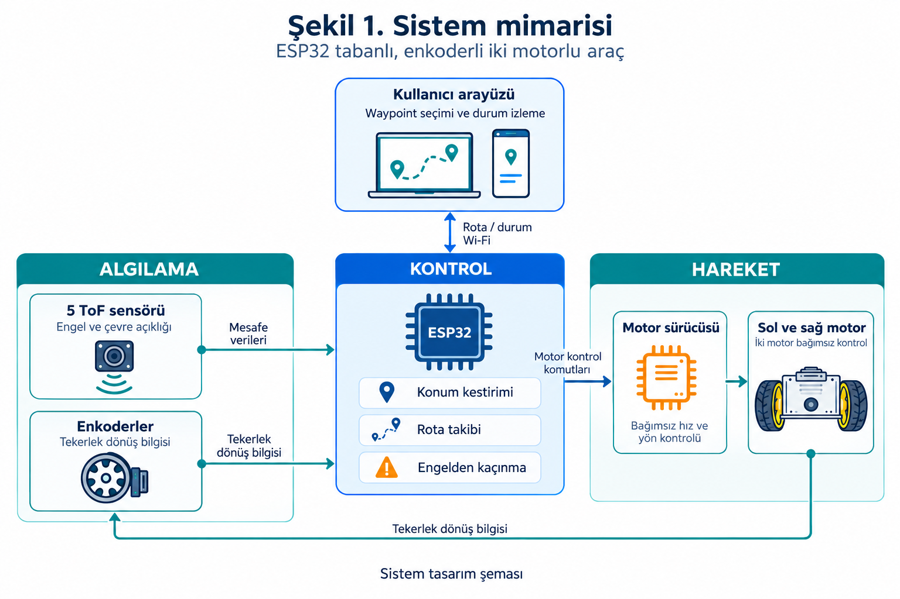
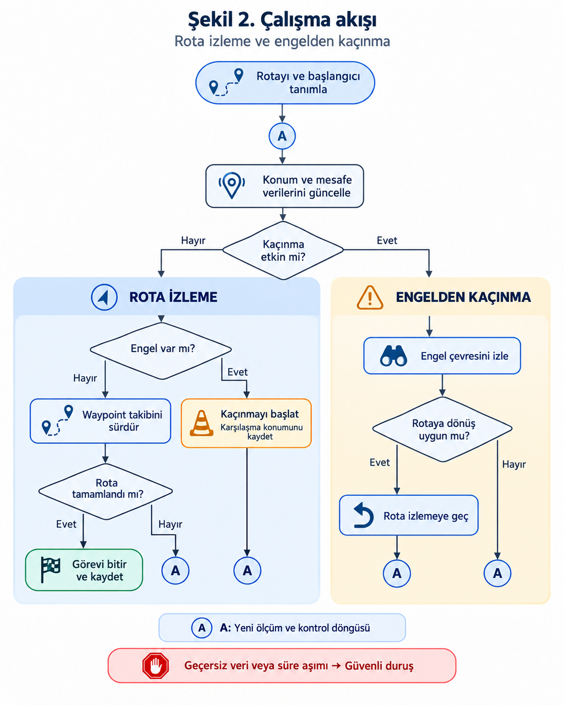
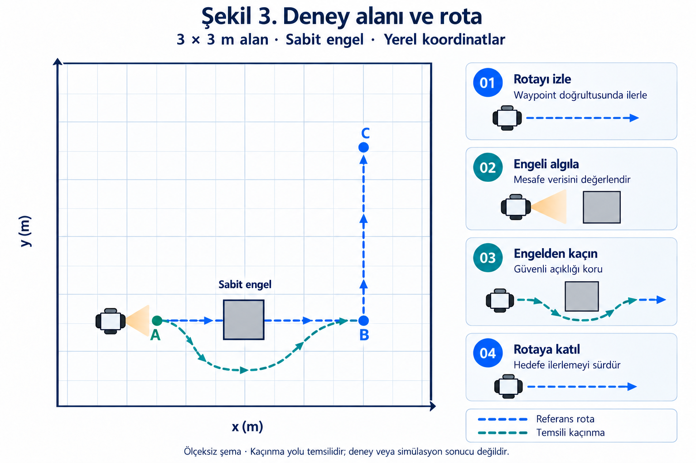

# TÜBİTAK 2209-A

**ÜNİVERSİTE ÖĞRENCİLERİ ARAŞTIRMA PROJELERİ DESTEKLEME PROGRAMI**

**ARAŞTIRMA ÖNERİSİ**

**Kullanıcı tarafından belirlenen rota bilgisine göre hareket eden otonom araç tasarımı**

**Proje yürütücüsü**  
Ahmet Talha Arslan

**Akademik danışman**  
Prof. Dr. Murat Ceylan

**Konya Teknik Üniversitesi**  
Elektrik-Elektronik Mühendisliği

**2026 YILI**

<!-- KAPAK SONU -->

## A. GENEL BİLGİLER

| Alan | Bilgi |
| --- | --- |
| Başvuru sahibinin adı soyadı | Ahmet Talha Arslan |
| Araştırma önerisinin başlığı | Kullanıcı tarafından belirlenen rota bilgisine göre hareket eden otonom araç tasarımı |
| Akademik danışman | Prof. Dr. Murat Ceylan |
| Üniversite / bölüm | Konya Teknik Üniversitesi / Elektrik-Elektronik Mühendisliği |
| Öğrenim düzeyi | Lisans, 4. sınıf |
| Proje ekibi | Bir öğrenci yürütücü |
| Proje süresi | 6 ay |
| Talep edilen destek | 11.500 TL; KDV dahil tahmini bütçe |

## ÖZET

Bu araştırmada, kullanıcı tarafından tanımlanan rotayı izleyen, sabit engelleri algılayıp çarpışmadan kaçınarak rotasına dönen küçük ölçekli bir otonom kara aracı geliştirilecektir. Araştırmanın temel sorusu, aynı rota üzerindeki farklı engel yerleşimlerinin algılama, kaçınma, rotaya dönüş ve görev tamamlama başarısını nasıl etkilediğidir.

Sistem; ESP32 kontrol birimi, bağımsız sürülen iki enkoderli motor ve beş sabit uçuş süresi (ToF) mesafe sensöründen oluşacaktır. Bilgisayar öncelikli, telefondan da erişilebilir web arayüzünde yerel koordinatlarla sıralı ara rota noktaları (waypoint) tanımlanacaktır. Enkoder tabanlı konum kestirimi ve mesafe ölçümleriyle hareket kontrol edilecek; engelden kaçınma ve rotaya yeniden katılma, Bug 2 yaklaşımından yararlanan bir durum makinesiyle gerçekleştirilecektir.

Düz zeminde 3 × 3 metrelik kontrollü alanda, engelsiz referans ve üç sabit engel yerleşimi değerlendirilecektir. Her koşulda 10 tekrar olmak üzere toplam 40 geçerli deneme yapılacaktır. Her engelli koşulda en az 8/10 denemede temas öncesi algılama, çarpışmasız kaçınma, rotaya dönüş ve hedefe ulaşmanın birlikte sağlanması hedeflenmektedir. Waypoint erişimi ve rotaya dönüş için 10 cm tolerans, görev tamamlama için 120 saniye üst sınırı kullanılacaktır. Hareket, mevcut telefonla alınacak sabit görüntü kaydı üzerinden bağımsız olarak değerlendirilecektir. Başarı oranları, tamamlanma süreleri ve rota izleme hataları raporlanacaktır.

Altı aylık çalışma, donanım ve kalibrasyon, arayüz, rota takibi, engelden kaçınma ile deney ve analizden oluşan beş iş paketinde yürütülecektir. Beklenen çıktılar bir araç prototipi, rota arayüzü, deney kayıt kümesi ve sürümlenmiş yazılım ile teknik dokümantasyondur. Çalışmanın, gömülü kontrol ve mobil robotik alanında deneysel bir eğitim ve geliştirme altyapısı oluşturması beklenmektedir.

**Anahtar kelimeler:** Otonom kara aracı, rota takibi, engelden kaçınma, enkoder, gömülü kontrol.

## 1. ARAŞTIRMA ÖNERİSİNİN BİLİMSEL NİTELİĞİ

### 1.1. Konunun önemi ve araştırma önerisinin bilimsel niteliği

**Araştırma problemi ve önemi**

Otonom kara araçlarında rota takibi, aracın konum ve yön bilgisinin hareket kontrolüyle birlikte değerlendirilmesini gerektirir. İki tekeri bağımsız sürülen mobil robotların kinematik modeli, tekerleklerin hareketi ile aracın doğrusal ve açısal hareketi arasındaki ilişkiyi tanımlar. Bu nedenle kullanıcı tarafından belirlenen bir rotanın fiziksel ortamda izlenmesi, yalnızca hareket komutlarının gönderilmesine değil, aracın yöneliminin ve hareketinin uygun biçimde izlenmesine de bağlıdır (Dellaert ve Hutchinson, t.y.). Rota üzerinde engel bulunması durumunda ise aracın engeli algılaması, çarpışmadan kaçınacak bir hareket üretmesi ve hedefe ilerleyişini sürdürebilmesi gerekir.

**Literatürdeki yaklaşımlar ve projenin konumu**

Hareket planlama literatüründe yerel engel bilgisini kullanan Bug türü yöntemler, önceden tüm engellerin haritası bilinmeden hedefe yönelik hareketin ele alınabildiği yaklaşımlar arasındadır. Bu yöntemlerin incelenmesinde robotun konumuna, engel geometrisine ve algılama biçimine ilişkin varsayımlar önem taşır. Ayrıca robotun fiziksel boyutlarının dikkate alınması, noktasal bir modelle bulunan yolun gerçek bir araçta uygulanabilirliğinin değerlendirilmesi açısından gereklidir (Hauser, t.y.-a).

Alajlan vd. (2017), FEZ Cerbot platformunda kızılötesi sensörler, ultrasonik sensör ve araç üzeri kamerayı birleştirerek sabit ve kısmen dinamik engelli senaryoları incelemiştir. Bu çalışma, algılama kapsamının hareket kararlarıyla birlikte tasarlanmasına örnek oluşturmaktadır. Bu araştırmada ise beş sabit mesafe sensörünün sağladığı yerel bilgiyle sabit engeller çevresinde kaçınma davranışı değerlendirilecektir. Telefonla yapılacak görüntü kaydı, aracın hareketini bağımsız olarak ölçmek amacıyla kullanılacaktır. Algılama altyapısı ve deney koşulları farklı olduğundan, ilgili yayındaki performans sonuçları bu prototip için öngörülen başarı değerleri olarak alınmayacaktır.

Koordinat tabanlı uygulamalarda Iqbal vd. (2023), yapı modelinden çıkarılan koordinatların masaüstü uygulaması ve bulut bağlantısı üzerinden ESP32 tabanlı bir mobil robota aktarılmasıyla zemin çizimi gerçekleştiren bir sistem sunmuştur. Rodrigues vd. (2026) ise enkoderler, dış kamera temelli konum bilgisi ve ESP32 gömülü kontrol katmanını içeren küçük bir diferansiyel sürüşlü robotta yörünge takibini deneysel olarak değerlendirmiştir. Bu örnekler, koordinat aktarımı, konum bilgisi ve motor kontrolünün farklı mimarilerle bütünleştirilebildiğini göstermektedir. Önerilen projede ele alınacak değerlendirme görevi, kullanıcının tanımladığı rota üzerinde yerel algıyla engelden kaçınma ve rotaya yeniden katılmadır. Çalışmanın bilimsel çerçevesi, bu davranışın seçilen donanım ve sınırlı deney koşullarında hangi aşamalarda başarılı veya başarısız olduğunun tekrarlı ölçümlerle incelenmesine dayanmaktadır.

**Araştırma sorusu, kapsam ve beklenen katkı**

Araştırma problemi, mikrodenetleyici tabanlı bir aracın kullanıcı tanımlı rotada karşılaştığı sabit engelleri aşarak aynı rota üzerindeki görevini sürdürebilmesidir. Bu problem, düz zeminde yaklaşık 3 × 3 metre olarak planlanan kontrollü alanda incelenecektir. Aynı referans rota üzerinde engelin yeri değiştirilerek algılama, kaçınma, rotaya dönüş ve görevi tamamlama aşamalarındaki başarı ve başarısızlıklar karşılaştırılacaktır.

Çalışmanın araştırma sorusu, “Sabit engellerin yerleşimi, kullanıcı tanımlı waypoint rotalarını izleyen küçük ölçekli bir kara aracında engel algılama, çarpışmasız kaçınma ve rotaya yeniden katılma başarısını nasıl etkiler?” biçiminde ele alınmaktadır. Geliştirilecek prototip üzerinde tekrarlanabilir deneyler gerçekleştirilmesi, başarılı ve başarısız durumların kaydedilmesi ve performansın ölçülebilir göstergelerle açıklanması amaçlanmaktadır. Kalibrasyon ve değerlendirmede güvenilir referans ölçümleri kullanılması, sensör çıktıları ile fiziksel hareket arasındaki ilişkinin incelenmesine dayanak sağlayacaktır (Hauser, t.y.-b). Bu kapsamda beklenen katkı; kullanıcı arayüzü, gömülü kontrol ve engelden kaçınma davranışının bütünleştirildiği bir prototip ile sınırları tanımlı deney koşullarına ait performans verilerinin oluşturulmasıdır.

### 1.2. Amaç ve hedefler

Projenin amacı, kullanıcı tarafından belirlenen waypoint rotasını izleyen küçük ölçekli bir kara aracında sabit engelin temas öncesinde algılanmasını, çarpışmasız kaçınma hareketinin gerçekleştirilmesini ve aynı rotaya yeniden katılarak görevin sürdürülmesini sağlayan bir prototip geliştirmektir. Bu bütünleşik davranışın başarısı, engel yerleşiminin değiştirildiği kontrollü ve tekrarlı deneylerle değerlendirilecektir.

Bu amaca yönelik hedefler şunlardır:

1. Yerel koordinatlarla sıralı rota tanımlama, rotayı araca aktarma, başlatma/durdurma ve görev durumunu izleme işlevlerini bilgisayar ve telefon tarayıcısında sunan bir arayüz geliştirmek.
2. İki enkoderli motor, beş sabit ToF sensörü ve ESP32'yi bütünleştirmek; tekerlek hareketi, dönüş, sensör kapsaması ve durma davranışı için kalibrasyon kayıtları oluşturmak.
3. Engel algılama, engel kenarını izleme ve rotaya dönüş davranışlarını durum/geçiş kurallarıyla gerçekleştirmek; waypoint sırasını kaçınma boyunca korumak.
4. Engelsiz referans ve üç sabit engel yerleşiminde koşul başına 10, toplam 40 geçerli değerlendirme denemesi yürütmek.
5. Her engelli koşulda en az 8/10 denemede temas öncesi algılama, çarpışmasız kaçınma, rotaya dönüş ve sıralı hedeflere erişimi 120 saniye içinde birlikte sağlamak. Waypoint erişiminde ve rotaya dönüşte 10 cm tolerans kullanmak.
6. Başarılı ve başarısız denemeleri birlikte raporlamak; aşama bazlı başarı oranları, tamamlanma süreleri ve bağımsız görüntü ölçümünden elde edilen rota hatalarıyla engel yerleşimlerinin etkisini açıklamak.

Bu sayısal değerler araştırmanın başarı hedefleridir; çalışma sonunda ölçülecek performansı tanımlar.

## 2. YÖNTEM

### 2.1. Araştırma tasarımı ve iş paketleriyle ilişki

Araştırma, prototip geliştirme ve kontrollü koşullarda tekrarlı deney tasarımına dayanmaktadır. Temel bağımsız değişken, aynı referans rota üzerindeki sabit engelin yerleşimidir. Bağımlı değişkenler; temas öncesi algılama, çarpışmasız kaçınma, rotaya dönüş ve görev tamamlama sonuçları ile süre ve rota izleme hatasıdır. Engel sayısı, boyutu ve yüzeyi engelli koşullar arasında sabit tutulacaktır. Başlangıç konumu/yönü, rota, zemin, hız ayarları ve son yazılım sürümü koşullar arasında değiştirilmeyecektir. Pil gerilimi, aydınlatma ve kontrol edilemeyen değişimler kaydedilecektir.

Donanım ve kalibrasyon İP1, arayüz ve haberleşme İP2, konum kestirimi ve rota takibi İP3, kaçınma ve rotaya dönüş İP4 kapsamında geliştirilecektir. Bütünleşik sistemin dört koşulda değerlendirilmesi ve veri analizi İP5 kapsamında yapılacaktır. Geliştirme/ayar denemeleri, nihai 40 değerlendirme denemesinden ayrı tutulacaktır.

### 2.2. Donanım mimarisi ve bileşen gereksinimleri

Araç, iki tahrik tekerinin bağımsız sürüldüğü ve bir serbest tekerlekle desteklendiği diferansiyel sürüş düzeninde kurulacaktır. Başlangıç mekanik tasarımında gövde zarfı en çok 25 × 20 cm olacak; tekerlekler, sensörler ve bağlantılar dahil gerçek dış ölçüler kaydedilecektir. Araç referans noktası, iki tahrik tekeri arasındaki aksın orta noktası olarak tanımlanacaktır.

ESP32, enkoderleri okuyacak, mesafe ölçümlerini işleyecek, hareket kararlarını verecek ve motorları sürecektir. Bileşenler aşağıdaki işlevsel gereksinimlerle temin edilecektir. Ticari ürün kodu yerine bu gereksinimlerin esas alınması, eşdeğer ürünlerle aynı araştırma yönteminin uygulanmasını sağlayacaktır.

| Bileşen | Miktar | Teknik gereksinim ve kullanım |
| --- | --- | --- |
| ESP32 geliştirme kartı | 1 | Wi-Fi, 3,3 V sayısal arayüzler, enkoder okumaya ve iki motorun bağımsız hız/yön kontrolüne yeterli giriş/çıkış. |
| Enkoderli DC motor | 2 | Aynı model, redüktörlü; 5 V motor beslemesinde 0,10 m/s araç hızını sağlayan tork/hız ve 3,3 V uyumlu ya da seviyelendirilmiş A/B geri bildirim çıkışları. |
| Çift kanallı motor sürücü düzeni | 1 takım | 3,3 V kontrol uyumu; her kanalın sürekli ve kısa süreli akım kapasitesinin motorun yük ve kalkış/sıkışma gereksinimlerini karşılaması. |
| Sabit ToF mesafe sensörü | 5 | Ön orta, iki ön çapraz ve iki yan yerleşim; 3,3 V uyumlu taşıyıcı arayüzü; beşli taramayı 200 ms içinde tamamlayan ölçüm düzeni ve geçersiz ölçüm bilgisinin okunması. |
| I²C çoklayıcı | 1 | Beş sensörü ayrı kanallardan seçerek okumaya uygun, en az beş kanallı ve 3,3 V mantık uyumlu düzen. |
| Güç altyapısı | 1 takım | Hazır 2S batarya, kimyası ve bağlantılarıyla uyumlu şarj cihazı, paket koruması, 5 V ve 3,3 V düzenlenmiş besleme dalları. |

Sensörlerin başlangıç yönleri ileri eksene göre 0°, ±45° ve ±90° olacaktır. Ön sensörler yaklaşan engeli, yan sensörler engel kenarındaki açıklığı izleyecektir. Montaj yüksekliği, ışınların deney engelini göreceği biçimde ayarlanacak; gerçek kapsama ve kör bölgeler kalibrasyon kaydına işlenecektir. Beş sensörün varlığı kesintisiz çevre algısı olarak yorumlanmayacaktır.

Motorlar ve kontrol elektroniği ayrı güç kablo dallarından beslenecek, ortak toprak referansı kullanılacaktır. Bataryanın ham gerilimi motorlara veya ESP32 giriş/çıkışlarına uygulanmayacaktır. Motor sürücüsü, regülatör, kablo ve koruma elemanları iki motorun birlikte kalkış/yük akımı esas alınarak boyutlandırılacaktır. Ürünlerin gerilim, akım, bağlantı ve şarj uyumu, montajın giriş kontrolünde veri sayfaları ve elektriksel kontrollerle doğrulanacaktır.

**Şekil 1.** Kullanıcı arayüzü, algılama, ESP32 ve motor sürme birimleri arasındaki veri akışı. ÜYZ desteğiyle hazırlanmış tasarım şemasıdır; simgeler temsilidir.

### 2.3. Konum kestirimi ve rota takibi

Tekerlek yarıçapları, iki tekerlek arasındaki açıklık ve çıkış mili devri başına sayılan enkoder kenarı sayısı kalibrasyonla kaydedilecektir. Motor mili/çıkış mili çözünürlüğü ve sayım yöntemi birbirinden ayrılacaktır. Diferansiyel sürüş kinematiğiyle tekerlek hareketlerinden göreli konum ve yön hesaplanacaktır (Dellaert ve Hutchinson, t.y.).

$$\Delta s=\frac{\Delta s_R+\Delta s_L}{2},\qquad \Delta\theta=\frac{\Delta s_R-\Delta s_L}{b}$$

Burada $\Delta s_R$ ve $\Delta s_L$ sağ ve sol tekerleğin katettiği yolları; $b$ tekerlekler arası açıklığı gösterir. Konum, her adımda orta yönelim kullanılarak güncellenecektir. Başlangıç konumu ve yönü işaretli alan üzerinde ayarlanacak, her denemede enkoder başlangıç değerleri kaydedilecektir.

Sıradaki waypoint'e yönelim hatası üzerinden açısal hız komutu üretilecek; hedefe yaklaşırken doğrusal hız azaltılacaktır. Motor hızları enkoder geri bildirimiyle ayrı ayrı kapalı çevrim kontrol edilecektir. Köşe waypoint'inde erişim doğrulandıktan sonra sonraki parçaya yönelinecek; kaçınma sırasında etkin hedef ve yüklenen sıra korunacaktır. Nominal düz ilerleme hızı 0,10 m/s, kaçınma ilerleme hızı en çok 0,05 m/s olarak planlanmıştır. Yerinde yönelme hareketlerinde gövdenin taradığı alan dikkate alınacaktır.

Denetim döngüsü 20 Hz olarak kurulacak; beş sensörün tam taraması en az 5 Hz, görev telemetrisi 5 Hz olacak şekilde zamanlama düzenlenecektir. Sensörler ayrı kanallardan sıralı okunacaktır. Üretici durum kodlarına göre geçerli bir engel-yok çıktısı ile iletişim/ölçüm hatası ayrılacak; belirsiz veri boş yol kabul edilmeyecektir. Ölçüm zaman damgaları tutulacak; 250 ms'den eski veya geçersiz engel verisiyle hareket sürdürülemeyecektir. Tekerlek kayması ve odometrik sürüklenme, bağımsız ölçümle izlenecektir.

### 2.4. Kullanıcı arayüzü ve haberleşme

Arayüz HTML, CSS ve JavaScript ile hazırlanacak; ESP32'nin oluşturacağı yerel Wi-Fi ağı üzerinden bilgisayar ve telefon tarayıcısında açılacaktır. Kullanıcı, metre ölçekli kareli alan üzerinde başlangıç konumu/yönünü ve waypoint'leri sıralı belirleyecektir. Koordinatların yerel olması, çizilen rotanın deney alanıyla doğrudan ilişkilendirilmesini sağlayacaktır.

Rota JSON biçiminde HTTP üzerinden aktarılacak, durum ve komutlar WebSocket bağlantısıyla iletilecektir. ESP-IDF HTTP sunucusunun WebSocket desteği, bu haberleşme düzeninin teknik dayanağıdır (Espressif Systems, t.y.). Alan dışındaki noktalar ve sıfır uzunluklu ardışık parçalar yükleme sırasında reddedilecektir. Başlatma için rota kabulü, geçerli sensör verisi ve uygun besleme durumu aranacaktır.

Arayüzde tahmini konum, etkin waypoint, mesafe ölçümleri, görev durumu ve hata nedeni gösterilecektir. Hareket kararları araç üzerinde verilecek; kullanıcı rota yüklendikten sonra aracı elle yönlendirmeyecektir. Arayüz 0,5 saniyede bir bağlantı canlılık mesajı gönderecek; 1 saniye boyunca bu mesaj alınamazsa motorlar durdurulacaktır. Durdurma komutu veya hata sonrasında hareket, kendiliğinden yeniden başlamayacaktır. Şasi üzerindeki erişilebilir ana güç anahtarı, gerektiğinde motor beslemesini fiziksel olarak kesmek için kullanılacaktır.

### 2.5. Engel algılama, kaçınma ve rotaya dönüş

Kaçınma, Bug 2 yaklaşımının engel kenarını izleme ve hedef doğrultusuna yeniden katılma mantığından yararlanan bir durum makinesiyle gerçekleştirilecektir (Hauser, t.y.-a). Temel durumlar bekleme, rota izleme, engel yaklaşımı/durma, kenar izleme, rotaya dönüş doğrulama, görev tamamlandı ve hata/durdurma olacaktır.

Engel algılama eşiği, sensörün araç gövdesine göre ofseti, algılama/karar gecikmesinde alınan yol, ölçülen durma mesafesi ve 5 cm açıklık payından türetilecektir. Gövde ön sınırı esas alındığında eşik en az 20 cm olacaktır; kalibrasyon daha büyük mesafe gerektirirse artırılacaktır. Böylece sensörün bildirdiği uzaklık doğrudan gövde açıklığı sayılmayacaktır. Bu ayar tüm nihai deneylerde sabit tutulacaktır.

Engel algılandığında araç yavaşlayıp duracak; kaçınmaya başlama konumu ile etkin hedefe uzaklık kaydedilecektir. Araç başlangıçta sağa yönelip engeli solunda tutarak kenar izleyecektir. Sol yan mesafe ölçümüyle gövde–engel açıklığı için 10 cm nominal değer izlenecek; ön ve çapraz ölçümler dönüş kararlarında kullanılacaktır. Kontrol, sensör ofsetleri ve gövdenin tamamı için geçiş açıklığını dikkate alacaktır. Kör bölgeye doğrulanmamış geri hareket komutu verilmeyecektir.

Rotaya yeniden katılma için aşağıdaki koşullar birlikte aranacaktır:

1. Araç referans noktasının etkin **sonlu rota parçasına** uzaklığı en çok 10 cm olmalıdır.
2. Etkin hedefe uzaklık, kaçınma başlangıcına göre en az 10 cm ve konum belirsizliğini aşan miktarda azalmış olmalıdır.
3. Engel geride kalmalı ve aracın tüm gövdesi için ilerleme açıklığı bulunmalıdır.
4. Araç dönüş bandında en az 1 saniye kalmalı ve aynı hedef yönünde en az 10 cm ilerlemelidir. Sıradaki waypoint'e erişim bu süreçte gerçekleşirse hedef değişimi dönüş doğrulamasından sonra yapılmalıdır.

İdeal Bug 2 algoritmasının tamlık özellikleri bu fiziksel uyarlama için garanti edilmeyecektir. Kaçınma başlangıç bölgesinden en az 20 cm uzaklaştıktan sonra bu konumun 10 cm çevresine hedefe ilerleme sağlayamadan geri dönme, döngü şüphesi olarak kaydedilecektir. Çarpışma, alan sınırına çıkma, geçersiz sensör verisi, haberleşme kaybı veya 120 saniye süre aşımında görev durdurulacaktır. Durdurma nedeni, deney sonucu ve günlük kaydıyla ilişkilendirilecektir; döngü kaydı ortamda hiçbir geçerli yol bulunmadığı biçiminde yorumlanmayacaktır.

**Şekil 2.** Rota izleme, engel algılama, kaçınma ve rotaya dönüş durumları arasındaki kontrol akışı. “A” bağlantıları kontrol döngüsüne dönüşü gösterir. ÜYZ desteğiyle hazırlanmış tasarım şemasıdır.

### 2.6. Deney alanı, koşullar ve uygulama sırası

Deneyler düz, kuru, kaymayan zeminde ayrılacak 3 × 3 metrelik kontrollü bir iç mekân alanında yürütülecektir. Bir köşe yerel koordinat sisteminin başlangıcı olacak; metre birimindeki rota **A=(0,75; 0,75), B=(2,25; 0,75), C=(2,25; 2,25)** şeklinde kurulacaktır. Noktalı virgül x ve y bileşenlerini ayırmaktadır. Toplam referans rota uzunluğu 3,00 metredir. Başlangıç yönü A'dan B'ye doğru olacaktır.

Engelli koşullarda aynı 30 × 30 cm tabanlı, 30 cm yüksekliğinde, opak ve mat yüzeyli tek prizmatik engel kullanılacaktır. Tüm koordinatlar araç referans noktası ve engel merkezi esas alınarak işaretlenecektir.

| Koşul | Engel merkezi (m) | İncelenen durum | Tekrar |
| --- | --- | --- | --- |
| K0 | Engel yok | Engelsiz rota takibi ve yanlış engel uyarıları | 10 |
| K1 | (1,40; 0,75) | İlk düz bölümde kaçınma ve aynı parçaya dönüş | 10 |
| K2 | (1,75; 0,75) | Köşe waypoint'ine yaklaşırken kaçınma ve dönüş | 10 |
| K3 | (2,25; 1,50) | Köşeden sonraki parçada kaçınma ve dönüş | 10 |

Geometri, araç gövdesi ve dönüşte taranan alanla birlikte kurulum aşamasında kontrol edilecektir. Nihai deneylere başlamadan önce engelin waypoint'leri kapatmadığı ve kaçış yönünde serbest geçiş bulunduğu doğrulanacaktır. Bu kontrol, deney sırasında koşul değiştirmek için kullanılmayacaktır.

Toplam 40 geçerli deneme, her blokta K0–K3 birer kez bulunacak şekilde 10 blokta uygulanacaktır. Blok içi sıra, önceden kaydedilen sabit bir rastgeleleştirme tohumu kullanılarak üretilecek ve deney kayıtlarıyla saklanacaktır. Her denemede başlangıç pozu yeniden kurulacak; batarya üreticisinin çalışma aralığı ve yük altındaki besleme kontrolü sağlanmadan görev başlatılmayacaktır. Koşullar son yazılım sürümü ve aynı parametrelerle karşılaştırılacaktır.

**Şekil 3.** Ölçeksiz şema: yerel koordinatlı deney alanı, waypoint rotası ve engelden kaçınmanın temsili gösterimi. Kesin deney koordinatları Bölüm 2.6'daki metin ve tabloda tanımlanmıştır. Çizilen kaçınma eğrisi ölçüm veya simülasyon sonucu değildir. Şema ÜYZ desteğiyle hazırlanmıştır.

### 2.7. Bağımsız ölçüm ve başarı ölçütleri

Aracın hareketi, yürütücünün mevcut telefonuyla en az 1080p ve 30 kare/saniye sabit görüntü kaydına alınacaktır. Telefonun konumu tüm alanı ve araç işaretini görecek biçimde kurulacaktır. Kamera konum bilgisi araç denetleyicisine verilmeyecek; bağımsız değerlendirme için kullanılacaktır.

Görüntü–metre dönüşümü, ölçülmüş konumdaki en az altı referans noktayla kurulacak; dönüşümde kullanılmayan ve alanı kapsayan en az beş kontrol noktasıyla sınanacaktır. Mercek bozulması ve araç üzerindeki işaretin yüksekliğinden kaynaklanan perspektif hatası düzeltilecektir. İzleme işareti aks orta noktasının üstüne yerleştirilecek; görüntü dönüşümünde işaretin bulunduğu yükseklik düzlemi esas alınacaktır. Kontrol noktalarında en çok 2 cm konum hatası çalışma hedefi olarak kullanılacak, ölçülen kalibrasyon hatası ve dinamik izlemenin ek belirsizlikleri ayrıca raporlanacaktır. Güvenilir referanslarla ölçüm doğrulama yaklaşımı, kalibrasyon çerçevesine dayanmaktadır (Hauser, t.y.-b).

Araç günlüğü ve video, görüntüde görülen ve günlükte zaman damgası bulunan ortak bir ışık olayıyla başlangıç ve bitişte eşlenecektir. Zaman eşleme hatası kaydedilecek; temas ile algılama sırası bu belirsizlik içinde ayırt edilemiyorsa temas öncesi başarılı algılama sayılmayacaktır. Konum, geçerli kayıt bölümlerinden 10 Hz eşit zaman aralığıyla örneklenecektir. Kayıp görüntü aralıkları ve değerlendirilebilen süre açıkça verilecektir.

| Ölçüt | Başarı kuralı | Kayıt / değerlendirme |
| --- | --- | --- |
| Temas öncesi algılama | Engel olayının ilk fiziksel temastan önce oluşması | Zaman eşlenmiş sensör günlüğü ve video |
| Çarpışmasız kaçınma | Gövde ve tekerlekler temas etmeden engelin geride bırakılması | Bağımsız video ve gövde açıklığı |
| Waypoint erişimi | Sıradaki noktaya uzaklık en çok 10 cm | Görüntüden sıralı erişim; ölçüm belirsizliği dikkate alınır |
| Rotaya dönüş | Sonlu parçaya en çok 10 cm uzaklık; Bölüm 2.5'teki açıklık, süre ve ilerleme koşulları | Bağımsız konum ve video |
| Görev tamamlama | Sıralı waypoint'lerden sonra son hedef bandında 2 saniye durma; toplam süre en çok 120 saniye | Süre hareketin başlamasından durma doğrulamasının bitimine kadar |
| Birleşik görev başarısı | K1, K2 ve K3'ün her birinde en az 8/10 denemede tüm aşamaların birlikte sağlanması | Her koşul ayrı değerlendirilir |

Waypoint ve rotaya dönüş için 10 cm, tüm hareket boyunca sağlanmış bir izleme hatası olarak yorumlanmayacaktır. Bir uzaklığın 10 cm sınırını karşıladığına ilişkin başarı kararı, ölçülen uzaklık ile ilgili konum belirsizliği toplamının bu sınırı aşmamasıyla verilecektir. Eşik çevresinde belirsiz kalan olaylar ayrı işaretlenecek ve başarılı sayılmayacaktır. Yalnızca engel önünde durmak veya elle yönlendirilerek devam etmek otonom başarı kabul edilmeyecektir.

### 2.8. Veri analizi ve başarısız denemelerin değerlendirilmesi

Algılama, kaçınma, rotaya dönüş ve görev tamamlama oranları her koşulda ayrı hesaplanacaktır. Payda, ilgili koşuldaki tüm geçerli denemeler olacaktır; sonraki aşamaya ulaşamayan denemeler bu aşamanın paydasından çıkarılmayacaktır. Engelsiz koşulda engel aşamaları uygulanmaz olarak kaydedilecek; görev başarısı ve yanlış engel uyarıları raporlanacaktır.

Tamamlanan görevlerin süreleri medyan ve en küçük–en büyük değerlerle özetlenecek; tamamlanamayan görevler, durdurma nedenleri ve süre aşımları ayrıca gösterilecektir. Her engelli koşul için en az 8/10 birleşik başarı hedefi ayrı sınanacaktır. Toplam engelli denemelerde 24/30 başarı elde edilmesi, tek başına koşul başına hedefin sağlandığını göstermeyecektir.

Rota hatası, aracın görüntüden ölçülen referans noktasının etkin sonlu rota parçasına en kısa uzaklığı olarak hesaplanacaktır. Etkin parça, waypoint'lere sıralı erişimin bağımsız doğrulanmasıyla seçilecektir. Parçanın sonsuz uzantısına uzaklık kullanılmayacaktır. Eşit aralıklarla örneklenen geçerli rota izleme verilerinden kök ortalama karesel hata hesaplanacaktır:

$$\operatorname{RMSE}=\sqrt{\frac{1}{N}\sum_{i=1}^{N}e_i^2}$$

Burada $e_i$ ilgili örnekteki sonlu parçaya uzaklığı, $N$ değerlendirilen örnek sayısını gösterir. Her deneme için RMSE, en büyük sapma ve veri kapsamı verilecek; kaçınmanın gerektirdiği geçici sapma ile normal rota takibi ve rotaya dönüş sonrası hata ayrı değerlendirilecektir. Kaçınma aralığı, engel olayından bağımsız olarak doğrulanan rotaya dönüşe kadar tanımlanacaktır.

Çarpışma, sınır dışına çıkma, denetleyici yeniden başlatması, bağlantı/sensör kaynaklı durdurma, döngü ve süre aşımı başarısız deneme olarak tutulacaktır. Yalnız araç davranışından bağımsız, sonucu değerlendirmeyi engelleyen video/harici kayıt hataları gerekçeleriyle geçersiz sayılabilecek ve aynı koşulda tekrar edilecektir. Araç başarısızlığı biliniyorsa eşzamanlı kayıt kaybı denemeyi dışlamak için kullanılmayacaktır. Başlatılan, geçersiz ve yerine yapılan deneme sayıları açıklanacaktır.

Ham sensör verileri, enkoderler, konum kestirimi, durum geçişleri ve video dosyaları ortak deneme kimliğiyle ilişkilendirilecektir. Yazılım/parametre değişikliği gerekirse eski kayıtlar korunacak ve karşılaştırılan koşullar yeni sürümle yeniden yürütülecektir. Kabul eşikleri sonuç görüldükten sonra gevşetilmeyecektir. Bulgular, dört koşul ve sınırlı tekrar sayısı içinde betimsel olarak yorumlanacak; tüm ortamlara genellenen başarı veya istatistiksel anlamlılık iddiası kurulmayacaktır.

### 2.9. Ön hazırlık ve uygulanabilirlik

Başvuru hazırlığında ilgili yayınlar ve teknik dokümanlar incelenmiş; sistem mimarisi, kontrol akışı, deney protokolü ve tahmini bütçe hazırlanmıştır. Fiziksel prototip, sensör/motor kalibrasyonu ve performans deneyleri proje kapsamında gerçekleştirilecektir. Benzer koordinat aktarımı ve gömülü kontrol uygulamaları (Iqbal vd., 2023; Rodrigues vd., 2026), yerel algıyla kaçınmaya ilişkin deneysel çalışma (Alajlan vd., 2017) ve hareket planlama çerçevesi (Hauser, t.y.-a) yöntem seçimlerine dayanak oluşturmaktadır. Bu kaynakların farklı donanımlardaki sonuçları önerilen araç için elde edilmiş sonuç sayılmayacaktır.

## 3. PROJE YÖNETİMİ

### 3.1. Çalışma takvimi

Proje altı ayda yürütülecektir. Aylar, değerlendirme sonuçlarının ilanına göre başlayan proje süresini gösterir. Tüm iş paketlerinin uygulama sorumlusu Ahmet Talha Arslan'dır; akademik danışman Prof. Dr. Murat Ceylan bilimsel yönlendirme ve değerlendirme sağlayacaktır.

| Dönem | İş paketi / faaliyet | Sorumlu | Başarı ölçütü | Katkı |
| --- | --- | --- | --- | --- |
| 1–2. ay | İP1 — Donanım entegrasyonu ve kalibrasyon | Ahmet Talha Arslan | İki motor/enkoder ve beş sensörün çalışması; düz ilerleme, dönüş, sensör kapsaması ve durma mesafesi kayıtlarının tamamlanması. | %20 |
| 1–2. ay | İP2 — Arayüz ve haberleşme | Ahmet Talha Arslan | Rota oluşturma/aktarma, başlatma/durdurma ve telemetri işlevlerinin bilgisayar ve telefon tarayıcısında doğrulanması; bağlantı kaybında durdurma. | %15 |
| 3. ay | İP3 — Konum kestirimi ve rota takibi | Ahmet Talha Arslan | A–B–C waypoint sırasının engelsiz ayar denemelerinde izlenmesi; 10 cm erişim ölçütünün ve bağımsız konum kaydının kontrolü. | %20 |
| 4–5. ay | İP4 — Engel algılama, kaçınma ve rotaya dönüş | Ahmet Talha Arslan | Durum geçişleri, açıklık ve dönüş kurallarının bütünleştirilmesi; ayar kayıtlarıyla nihai yazılım ve parametre sürümünün sabitlenmesi. | %30 |
| 6. ay | İP5 — Kontrollü deney ve performans analizi | Ahmet Talha Arslan | Toplam 40 geçerli deneme; her engelli koşulda en az 8/10 birleşik başarı hedefinin değerlendirilmesi; süre, hata ve başarısızlık analizinin tamamlanması. | %15 |

Başarıya katkı toplamı %100'dür. İlk iki ayda donanım ve arayüz çalışmaları kısmen paralel yürütülecektir. Rota takibine, hareket kalibrasyonu ve rota aktarımı tamamlandıktan sonra geçilecektir. Kaçınma entegrasyonu ve ayar denemelerini, son sürümün sabitlenmesi ile altıncı aydaki deneyler izleyecektir. Literatür incelemesi, temin ve raporlama ilgili teknik faaliyetlere eşlik edecek; bağımsız iş paketi yapılmayacaktır.

### 3.2. Risk yönetimi

| Risk | Önlem ve temel hedefi koruyan B planı | İlgili İP |
| --- | --- | --- |
| Kayma veya dönüşlerde biriken konum hatası | Tekerlek ölçeği/dönüş kalibrasyonu, daha düşük hız ve tutuş düzenlemesi uygulanacaktır. Yetersiz kalırsa tekerlek/aks yerleşimi ve motor redüksiyonu aynı işlevsel mimari içinde düzenlenecek; kalibrasyon tekrarlanacaktır. Başarı eşikleri ve bağımsız değerlendirme korunacaktır. | 1, 3, 4 |
| Sensör yüzeyi/kör alan nedeniyle geç algılama | Gerçek engelde kapsama ve durma mesafesi kontrol edilecektir. Yerleşim, okuma zamanlaması ve eşik kalibrasyonu düzeltilecek; gerekirse aynı beşli düzeni ve 3,3 V uyumu koruyan eşdeğer ToF taşıyıcısı kullanılacaktır. | 1, 4 |
| Kaçınmada döngü veya rotaya katılamama | Başlangıç noktası, ilerleme ve durum geçişleri kaydedilecektir. Kenar izleme ayarları geliştirme denemelerinde düzeltilecek; son sürümle tüm koşullar değerlendirilecektir. Kabul eşikleri düşürülmeyecektir. | 4, 5 |
| Besleme düşümü ve kontrol kesintisi | Motor/sürücü akımı ve besleme dalları yük altında kontrol edilecektir. Yetersiz güç bileşeni uygun akım kapasiteli eşdeğeriyle değiştirilecek; yeniden başlatma ve hata sonrası hareketin durduğu doğrulanacaktır. | 1, 4 |
| Görüntü ölçümünde yetersiz doğruluk veya kayıt kaybı | Sabitleme, yükseklik düzlemi, mercek düzeltmesi ve kontrol noktaları iyileştirilecektir. Gerekirse yine bağımsız kalan başka bir sabit görüntüleme düzeni kurulacak; yalnız ölçülebilen kapsam raporlanacaktır. | 1, 5 |
| Parça temini veya bütçe sapması | İşlevsel gereksinimleri karşılayan yerel eşdeğerler kullanılacaktır. İki enkoderli motor, beş sensör ve bağımsız değerlendirme korunacak; zorunlu olmayan görsel/mekanik süslemelerden vazgeçilecektir. | 1–5 |

B planları algılama, otonom kaçınma ve rotaya dönüş hedeflerini koruyacaktır. Donanım veya yöntem değişikliği sürümlenecek; karşılaştırılan deney koşulları aynı son düzenekle yürütülecektir.

### 3.3. Araştırma olanakları

Araştırma Konya Teknik Üniversitesi Elektrik-Elektronik Mühendisliği kapsamında, yürütücü ve akademik danışmanın bilimsel çalışması olarak yürütülecektir. Kurumsal laboratuvar veya cihaz tahsisi bu çalışma planında dayanak alınmamış; gerekli altyapı kişisel kaynaklar ve proje bütçesiyle tanımlanmıştır. Çalışma için gerekli 3 × 3 metrelik kontrollü alan, düz zemin ve tüm alanın sabit görüntülenmesi koşullarına göre düzenlenecektir.

| Kaynak / erişim durumu | Projede kullanım amacı |
| --- | --- |
| Yürütücünün mevcut lehim ekipmanı | Elektronik bağlantı ve araç montajı |
| Yürütücünün mevcut telefonu | Bağımsız deney videosu ve ölçüm kaydı |
| Proje bütçesinden sağlanacak kontrol, algılama ve hareket bileşenleri | Araç prototipinin kurulması |
| Proje bütçesinden sağlanacak multimetre, uzunluk ölçüm aracı, telefon sabitleme ve işaretleme malzemesi | Elektriksel kontrol, deney alanının kurulması ve görüntü kalibrasyonu |

Mevcut telefon ve lehim ekipmanı için yeni alım öngörülmemektedir. Tasarım, doğrulanmamış bir 3D yazıcı, özel imalat cihazı veya kurumsal robotik laboratuvarına erişim gerektirmeyecek biçimde, hazır mekanik parçalar ve basit bağlantı elemanlarıyla kurulacaktır.

## 4. ARAŞTIRMA ÖNERİSİNİN YAYGIN ETKİSİ

Çalışma, arayüz tasarımı, gömülü kontrol ve deneysel değerlendirmeyi aynı araç üzerinde bir araya getirecektir. Hedeflenen çıktılar aşağıda kullanım alanlarıyla birlikte verilmiştir.

| Çıktı kategorisi | Somut çıktı | Beklenen kullanım / etki |
| --- | --- | --- |
| Teknolojik | Bir otonom araç prototipi ve bilgisayar/telefon tarayıcısından kullanılan bir rota arayüzü | Tanımlı alanda rota aktarımı, sabit engelden kaçınma ve rotaya dönüşün birlikte gösterilmesi |
| Bilimsel / akademik | Bir deney protokolü, 40 geçerli denemeye ait kayıt kümesi ve performans değerlendirmesi | Engel yerleşimine göre başarı aşamaları, süre ve hata davranışlarının incelenmesi; uygun bulguların danışmanla bilimsel sunuma dönüştürülmesi |
| Eğitsel / teknik | Bir sürümlenmiş araç/arayüz yazılımı ve teknik dokümantasyon paketi | Gömülü sistem, sensör kalibrasyonu ve mobil robotik alanında incelenebilir öğrenci çalışma altyapısı |
| Yeni araştırmalar | Bulgulara dayalı sınırlılıklar ve geliştirme önerileri | Konum sürüklenmesinin azaltılması, farklı engel geometrileri ve sonraki rota planlama çalışmalarına dayanak |

Paylaşılabilir yazılım, bağlantı bilgileri ve deney düzeni, proje için kullanılan GitHub deposunda sürümlenecektir. Veri paylaşımında kişiler veya mekâna ait tanımlayıcı görüntüler ayıklanacak, bilimsel değerlendirme için gerekli araç/alan verileri korunacaktır. Çıktıların, yürütücünün gömülü kontrol, arayüz geliştirme ve deneysel analiz becerilerine katkı sağlaması beklenmektedir. Yayın veya sunum, elde edilecek bulguların niteliğine göre değerlendirilecektir.

## 5. BELİRTMEK İSTENEN DİĞER KONULAR

Araştırma düz zemindeki sabit engellerle sınırlandırılmıştır. Hareketli engeller, gerçek coğrafi harita/GPS kullanımı ve farklı zemin türleri ileride ele alınabilecek geliştirme alanlarıdır. Bu sınırlandırma, altı aylık sürede bütünleşik davranışın tekrarlı deneylerle incelenmesine odaklanmayı sağlayacaktır.

Önerinin hazırlanmasında ChatGPT/Codex araçlarından kaynak inceleme desteği, metin düzenleme ve belge üretimi; image_gen aracından üç tasarım şemasının hazırlanması için yararlanılmıştır. Bilimsel içerik, kaynaklar ve proje kararlarının sorumluluğu yürütücüye aittir; akademik danışmanın kontrolüne sunulmaktadır. Görseller tasarım şemalarıdır; üretilmiş prototip veya elde edilmiş deney sonucu göstermez.

## 6. EKLER

### Ek 1. Gerekçeli bütçe

Toplam destek talebi **11.500 TL**'dir. Aşağıdaki birim ve toplam bedeller KDV dahil tahmini maliyetlerdir; bağlayıcı satıcı teklifi niteliği taşımaz. Kalemler bir araç prototipi, beş sensörlü algılama düzeni ve 40 denemelik değerlendirme için planlanmıştır.

| Kalem | Miktar | Birim bedel | Toplam |
| --- | --- | --- | --- |
| K01 — ESP32 geliştirme kartı | 1 adet | 700,00 TL | 700,00 TL |
| K02 — Sabit ToF mesafe sensörü | 5 adet | 500,00 TL | 2.500,00 TL |
| K03 — I²C çoklayıcı | 1 adet | 100,00 TL | 100,00 TL |
| K04 — Gerekli sinyal seviye uyarlama ve bağlantı parçaları | 1 takım | 200,00 TL | 200,00 TL |
| K05 — Enkoderli DC motor | 2 adet | 600,00 TL | 1.200,00 TL |
| K06 — İki motor için uygun sürücü düzeni | 1 takım | 400,00 TL | 400,00 TL |
| K07 — İki tekerlek ve iki motor bağlantı aparatı | 1 takım | 400,00 TL | 400,00 TL |
| K08 — Boş şasi veya şasi imalatı | 1 adet | 750,00 TL | 750,00 TL |
| K09 — Serbest taşıyıcı tekerlek paketi | 1 paket | 100,00 TL | 100,00 TL |
| K10 — Uygun hazır batarya paketi | 1 adet | 1.200,00 TL | 1.200,00 TL |
| K11 — Bataryayla uyumlu şarj cihazı | 1 adet | 1.000,00 TL | 1.000,00 TL |
| K12 — 5 V ve 3,3 V gerilim düzenleme | 1 takım | 350,00 TL | 350,00 TL |
| K13 — Güç kablosu, anahtar, sigorta, konnektör ve gerekli paket koruması | 1 takım | 300,00 TL | 300,00 TL |
| K14 — Pertinaks, USB ve sinyal kabloları | 1 takım | 150,00 TL | 150,00 TL |
| K15 — Dahil olmayan vida, distans ve bağlantı elemanları | 1 takım | 250,00 TL | 250,00 TL |
| K16 — Sensör sabitleme aparatı/malzemesi | 5 adet | 60,00 TL | 300,00 TL |
| K17 — Alan ve kalibrasyon işaretleme malzemesi | 1 takım | 150,00 TL | 150,00 TL |
| K18 — Sabit deney engeli malzemesi | 1 adet | 150,00 TL | 150,00 TL |
| K19 — Mevcut telefon için sabitleme düzeni | 1 takım | 500,00 TL | 500,00 TL |
| K20 — Temel elektriksel kontroller için multimetre | 1 adet | 400,00 TL | 400,00 TL |
| K21 — Uzunluk ölçüm aracı | 1 adet | 100,00 TL | 100,00 TL |
| K22 — Yurt içi ürün teslim/kargo gideri | 1 takım | 300,00 TL | 300,00 TL |
| **TOPLAM** | | | **11.500,00 TL** |

Kontrol ve algılama için 3.500 TL, hareket/şasi için 2.850 TL, güç için 2.850 TL, montaj/bağlantı için 700 TL, deney düzeni için 1.300 TL ve yurt içi teslim için 300 TL ayrılmıştır. Kontrol ve algılama bileşenleri İP1–4'ün; deney düzeni ve ölçüm araçları İP1 ve İP5'in gereksinimlerini karşılayacaktır.

Mevcut telefon ve lehim ekipmanı yeniden bütçelenmemiştir. Hazır kitte bulunan parçalar ikinci kez alınmayacak; tedarik, Bölüm 2.2’de tanımlanan işlevsel uyum şartlarına göre yapılacaktır.

## KAYNAKLAR

- Alajlan, A., Elleithy, K., Almasri, M., Sobh, T. 2017. “An Optimal and Energy Efficient Multi-Sensor Collision-Free Path Planning Algorithm for a Mobile Robot in Dynamic Environments”, *Robotics*, 6(2), 7. DOI: https://doi.org/10.3390/robotics6020007.

- Dellaert, F., Hutchinson, S. t.y. “Motion Model for the Differential Drive Robot”. *Introduction to Robotics and Perception*, Bölüm 5.2. İnternet adresi: https://github.com/gtbook/robotics/blob/main/S52_diffdrive_actions.ipynb. Son erişim tarihi: 21 Ekim 2026.

- Espressif Systems. t.y. “HTTP Server”. *ESP-IDF Programming Guide*, v5.5.1. İnternet adresi: https://github.com/espressif/esp-idf/blob/v5.5.1/docs/en/api-reference/protocols/esp_http_server.rst. Son erişim tarihi: 21 Ekim 2026.

- Hauser, K. t.y.-a. “Motion planning in simple geometric spaces”. *Robotic Systems*, Bölüm 9. İnternet adresi: https://github.com/krishauser/RoboticSystemsBook/blob/master/GeometricMotionPlanning.ipynb. Son erişim tarihi: 21 Ekim 2026.

- Hauser, K. t.y.-b. “Calibration”. *Robotic Systems*, Bölüm 22. İnternet adresi: https://github.com/krishauser/RoboticSystemsBook/blob/master/Calibration.ipynb. Son erişim tarihi: 21 Ekim 2026.

- Iqbal, F., Ahmed, S., Amin, F., Qayyum, S., Ullah, F. 2023. “Integrating BIM–IoT and Autonomous Mobile Robots for Construction Site Layout Printing”, *Buildings*, 13(9), 2212. DOI: https://doi.org/10.3390/buildings13092212.

- Rodrigues, V. O. B., Silva, G. A. A., Pugliese, L. F., Silva, W. W. A. G., Monte-Mor, J. A., Karolak, D. B., Gomides, L. M., Braga, R. A. S. 2026. “Hierarchical Control Architecture for Trajectory Tracking of Differential-Drive Nonholonomic Robots Using LQG-Based Velocity Control”, *Robotics*, 15(9), 171. DOI: https://doi.org/10.3390/robotics15090171.
