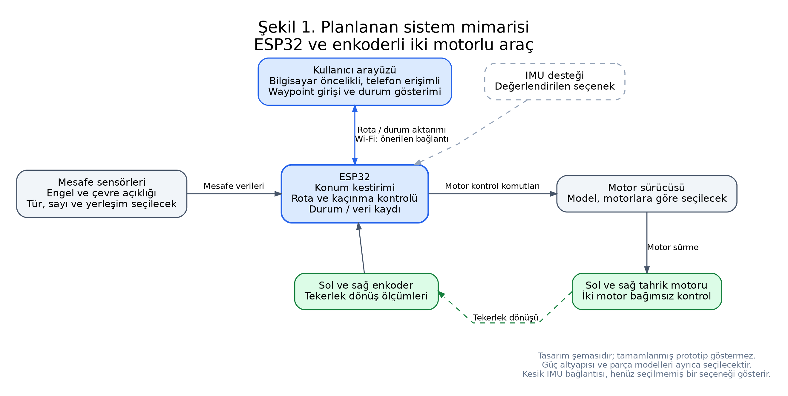
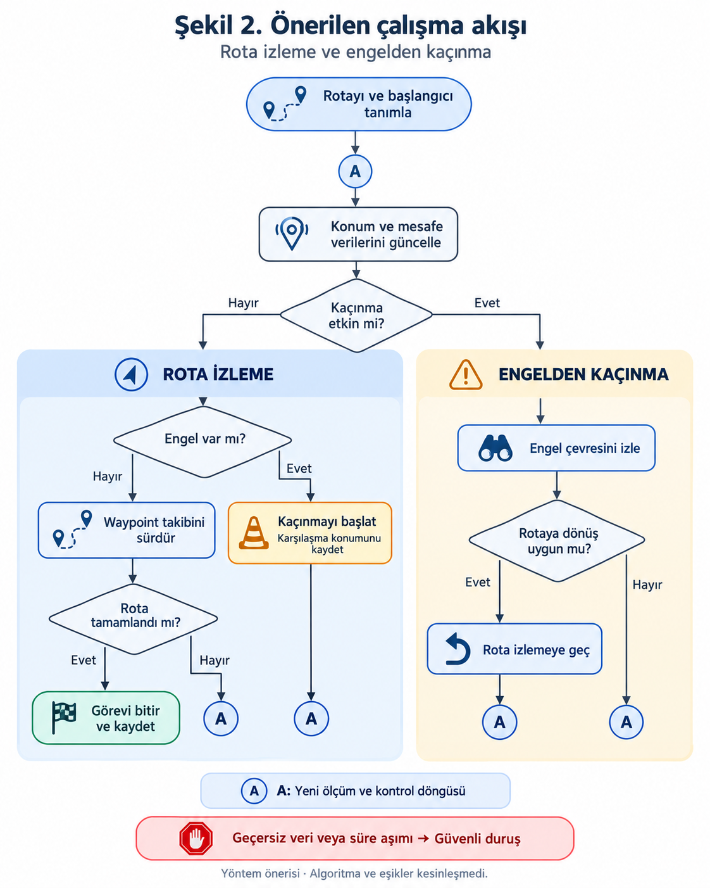
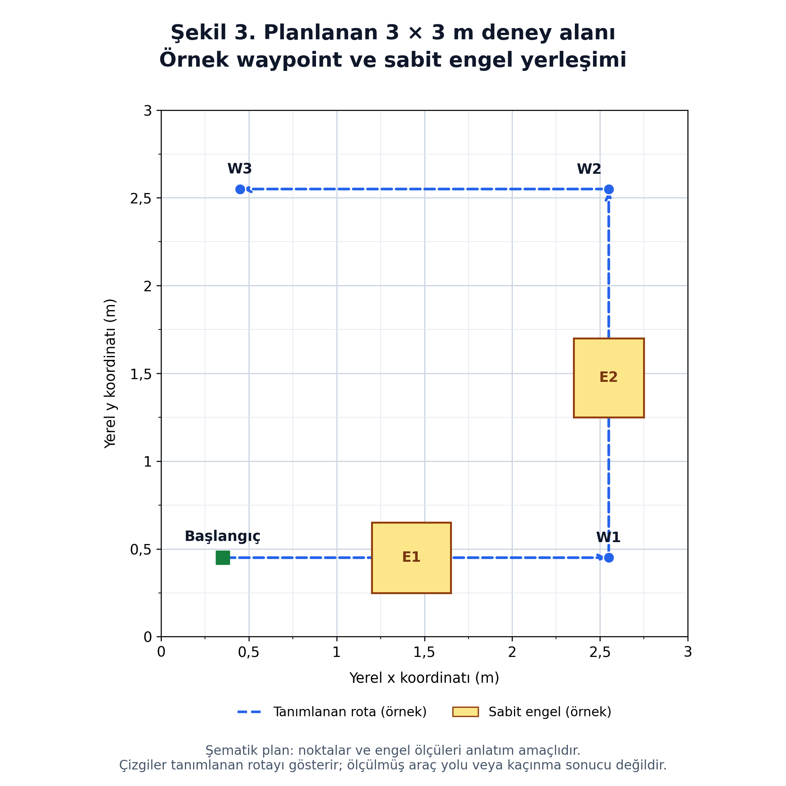

# TÜBİTAK 2209-A — Araştırma Önerisi

**Birleşik metin taslağı · 22 Ekim 2026 · Anlatım ve bölüm düzeni güncellemesi**

**Proje adı:** Kullanıcı tarafından belirlenen rota bilgisine göre hareket eden otonom araç tasarımı

İnceleme taslağıdır; açık bilgiler [hazırlık notlarında](https://github.com/ahmet-talha21/Bitirme_Projesi_IKA/blob/main/docs/2209-A/BASVURU_METNI_HAZIRLIK_NOTLARI.md) tutulmaktadır.

## Genel bilgiler

| Alan | Bilgi |
| --- | --- |
| Proje yürütücüsü | Ahmet Talha Arslan |
| Üniversite / bölüm | Konya Teknik Üniversitesi / Elektrik-Elektronik Mühendisliği |
| Öğrenim durumu | Lisans, 4. sınıf |
| Akademik danışman | Prof. Dr. Murat Ceylan |
| Proje ekibi | Tek öğrenci yürütücü |
| Akademik teslim hedefi | Haziran 2027; kesin gün henüz belli değil. |
| Planlanan proje süresi | 6 ay; resmî takvim sonuçların ilanına göre başlayacaktır. |
| Planlanan destek talebi | 11.500 TL; KDV dahil tahmini bütçe. |

## Özet

Bu araştırmada, kullanıcı tarafından arayüzde tanımlanan rotayı izleyen, sabit engelleri algılayıp çarpışmadan kaçınarak rotasına dönen küçük ölçekli bir otonom kara aracı geliştirilmesi amaçlanmaktadır. Farklı engel yerleşimlerinin algılama, kaçınma, rotaya dönüş ve görev tamamlama başarısına etkisi kontrollü deneylerle incelenecektir.

Prototip; ESP32 kontrol birimi, bağımsız sürülen iki enkoderli motor ve beş sabit mesafe sensöründen oluşacaktır. Kullanıcı, bilgisayar öncelikli ve telefondan erişimi de hedeflenen arayüzde yerel koordinatlarla ara rota noktaları (waypoint) belirleyecektir. Enkoder verilerinden hesaplanan göreli konum bilgisi, mesafe ölçümlerine dayalı hareket kararlarıyla birlikte kullanılacaktır. Engel çevresini takip etme ve rotaya dönüş davranışları, Bug 2 yaklaşımından yararlanan bir durum makinesiyle gerçekleştirilecektir.

Düz zeminde yaklaşık 3 × 3 metre olarak planlanan alanda engelsiz referans ve üç sabit engel yerleşimi karşılaştırılacaktır. Her koşul 10 kez tekrarlanarak toplam 40 geçerli değerlendirme denemesi yapılacaktır. Her engelli koşulda en az 8/10 denemede temas öncesi algılama, çarpışmasız kaçınma, rotaya dönüş ve hedefe ulaşmanın birlikte sağlanması hedeflenmektedir. Waypoint erişimi ve rotaya dönüş için en çok 10 cm uzaklık, deneme başına en çok 120 saniye hedeflenmektedir. Aracın hareketinin bağımsız değerlendirilmesinde, mevcut telefonla sabit görüntü kaydı ve kalibrasyon düzeni kurulması planlanmaktadır.

Çalışma, altı aylık beş iş paketinde yürütülecektir. Beklenen çıktılar bir araç prototipi, rota arayüzü, deney kayıt kümesi ve performans değerlendirmesiyle birlikte sürümlenmiş teknik dokümantasyondur.

**Anahtar kelimeler:** Otonom kara aracı, rota takibi, engelden kaçınma, enkoder, gömülü kontrol.

## 1. Bilimsel nitelik

### 1.1. Konunun önemi ve araştırma önerisinin bilimsel niteliği

**Araştırma problemi ve önemi**

Otonom kara araçlarında rota takibi, aracın konum ve yön bilgisinin hareket kontrolüyle birlikte değerlendirilmesini gerektirir. İki tekeri bağımsız sürülen mobil robotların kinematik modeli, tekerleklerin hareketi ile aracın doğrusal ve açısal hareketi arasındaki ilişkiyi tanımlar. Bu nedenle kullanıcı tarafından belirlenen bir rotanın fiziksel ortamda izlenmesi, yalnızca hareket komutlarının gönderilmesine değil, aracın yöneliminin ve hareketinin uygun biçimde izlenmesine de bağlıdır (Dellaert ve Hutchinson, t.y.). Rota üzerinde engel bulunması durumunda ise aracın engeli algılaması, çarpışmadan kaçınacak bir hareket üretmesi ve hedefe ilerleyişini sürdürebilmesi gerekir.

**Literatürdeki yaklaşımlar ve projenin konumu**

Hareket planlama literatüründe yerel engel bilgisini kullanan Bug türü yöntemler, önceden tüm engellerin haritası bilinmeden hedefe yönelik hareketin ele alınabildiği yaklaşımlar arasındadır. Bu yöntemlerin incelenmesinde robotun konumuna, engel geometrisine ve algılama biçimine ilişkin varsayımlar önem taşır. Ayrıca robotun fiziksel boyutlarının dikkate alınması, noktasal bir modelle bulunan yolun gerçek bir araçta uygulanabilirliğinin değerlendirilmesi açısından gereklidir (Hauser, t.y.-a).

Alajlan vd. (2017), FEZ Cerbot platformunda kızılötesi sensörler, ultrasonik sensör ve araç üzeri kamerayı birleştirerek sabit ve kısmen dinamik engelli senaryoları incelemiştir. Bu çalışma, algılama kapsamının hareket kararlarıyla birlikte tasarlanmasına örnek oluşturmaktadır. Bu araştırmada ise beş sabit mesafe sensörünün sağladığı yerel bilgiyle sabit engeller çevresinde kaçınma davranışı değerlendirilecektir. Telefonla yapılacak görüntü kaydı, aracın hareketini bağımsız olarak ölçmek amacıyla kullanılacaktır. Algılama altyapısı ve deney koşulları farklı olduğundan, ilgili yayındaki performans sonuçları bu prototip için öngörülen başarı değerleri olarak alınmayacaktır.

Koordinat tabanlı uygulamalarda Iqbal vd. (2023), yapı modelinden çıkarılan koordinatların masaüstü uygulaması ve bulut bağlantısı üzerinden ESP32 tabanlı bir mobil robota aktarılmasıyla zemin çizimi gerçekleştiren bir sistem sunmuştur. Rodrigues vd. (2026) ise enkoderler, dış kamera temelli konum bilgisi ve ESP32 gömülü kontrol katmanını içeren küçük bir diferansiyel sürüşlü robotta yörünge takibini deneysel olarak değerlendirmiştir. Bu örnekler, koordinat aktarımı, konum bilgisi ve motor kontrolünün farklı mimarilerle bütünleştirilebildiğini göstermektedir. Önerilen projede ele alınacak değerlendirme görevi, kullanıcının tanımladığı rota üzerinde yerel algıyla engelden kaçınma ve rotaya yeniden katılmadır. Çalışmanın bilimsel çerçevesi, bu davranışın seçilen donanım ve sınırlı deney koşullarında hangi aşamalarda başarılı veya başarısız olduğunun tekrarlı ölçümlerle incelenmesine dayanmaktadır.

**Araştırma sorusu, kapsam ve beklenen katkı**

Araştırma problemi, mikrodenetleyici tabanlı bir aracın kullanıcı tanımlı rotada karşılaştığı sabit engelleri aşarak aynı rota üzerindeki görevini sürdürebilmesidir. Bu problem, düz zeminde yaklaşık 3 × 3 metre olarak planlanan kontrollü alanda incelenecektir. Aynı referans rota üzerinde engelin yeri değiştirilerek algılama, kaçınma, rotaya dönüş ve görevi tamamlama aşamalarındaki başarı ve başarısızlıklar karşılaştırılacaktır.

Çalışmanın araştırma sorusu, “Sabit engellerin yerleşimi, kullanıcı tanımlı waypoint rotalarını izleyen küçük ölçekli bir kara aracında engel algılama, çarpışmasız kaçınma ve rotaya yeniden katılma başarısını nasıl etkiler?” biçiminde ele alınmaktadır. Geliştirilecek prototip üzerinde tekrarlanabilir deneyler gerçekleştirilmesi, başarılı ve başarısız durumların kaydedilmesi ve performansın ölçülebilir göstergelerle açıklanması amaçlanmaktadır. Kalibrasyon ve değerlendirmede güvenilir referans ölçümleri kullanılması, sensör çıktıları ile fiziksel hareket arasındaki ilişkinin incelenmesine dayanak sağlayacaktır (Hauser, t.y.-b). Bu kapsamda beklenen katkı; kullanıcı arayüzü, gömülü kontrol ve engelden kaçınma davranışının bütünleştirildiği bir prototip ile sınırları tanımlı deney koşullarına ait performans verilerinin oluşturulmasıdır.

### 1.2. Amaç ve hedefler

Projenin amacı, kullanıcı tanımlı waypoint rotasını izleyen küçük ölçekli bir kara aracında sabit engelin temas öncesinde algılanmasını, çarpışmasız kaçınma hareketinin gerçekleştirilmesini ve rotaya yeniden katılarak görevin sürdürülmesini sağlayan bir prototip geliştirmek; bu davranışın başarısını sınırları tanımlanmış deney koşullarında değerlendirmektir. Arayüz tasarımı, gömülü kontrol yazılımı ve donanım entegrasyonu proje yürütücüsü tarafından gerçekleştirilecektir.

Bu amaç doğrultusunda aşağıdaki hedefler izlenecektir:

1. Bilgisayar öncelikli ve telefondan da erişilebilir bir arayüzde yerel koordinatlarla rota tanımlama, rotayı araca aktarma, başlatma/durdurma ve görev durumunu izleme işlevlerini geliştirmek.
2. İki enkoderli motorun geri bildirimiyle rota izleme altyapısını kurmak; beş sabit mesafe sensörünün ön ve yan kapsamasını kalibrasyonla değerlendirmek.
3. Engel algılama, çarpışmasız kaçınma ve rotaya dönüşü açık durum/geçiş kurallarıyla bütünleştirmek.
4. Engelsiz referans ve üç sabit engel yerleşiminde koşul başına 10, toplam 40 geçerli değerlendirme denemesi yürütmek.
5. Her engelli koşulda en az 8/10 denemede temas öncesi algılama, çarpışmasız kaçınma, rotaya dönüş ve hedefe ulaşmayı 120 saniye içinde birlikte sağlamak; tüm geçerli başarısızlıkları da değerlendirmeye katmak.
6. Algılama, kaçınma, rotaya dönüş ve görev sonuçlarını ayrı kaydetmek; tamamlanma süresi ve bağımsız referansla ölçülebilen rota hatasını raporlamak.

Waypoint erişimi ve rotaya dönüş için 10 cm tolerans, her deneme için 120 saniye üst sınırı planlanmıştır. Bu hedeflerin uygulanabilirliği, donanım özellikleri ve bağımsız ölçüm düzeniyle değerlendirilecek; kalan durum geçişi ve kalibrasyon parametreleri başvuru öncesinde danışmanla gözden geçirilecektir.

## 2. Yöntem

### 2.1. Araştırma tasarımı

Araştırma, bir kara aracı prototipinin geliştirilmesi ve kontrollü koşullarda tekrarlı deneylerle değerlendirilmesi biçiminde yürütülecektir. Temel bağımsız değişken, aynı referans rota üzerindeki sabit engelin yerleşimidir. Engel boyutu, yüzeyi ve sayısı engelli koşullar arasında sabit tutulacak; birden çok değişkenin etkisi tek bir etki gibi yorumlanmayacaktır. Bağımlı değişkenler temas öncesi algılama, çarpışmasız kaçınma, rotaya dönüş ve görev tamamlama sonuçları ile süre ve rota sapmasıdır.

Başlangıç konumu ve yönü, referans rota, zemin, hız ayarı ve kontrol parametreleri koşullar arasında sabit tutulacak; pil gerilimi, aydınlatma ve kontrol edilemeyen değişimler kaydedilecektir. Yaklaşık 3 × 3 metre olarak planlanan alanın fiziksel yeri henüz belirlenmemiştir. Alanın yeterliliği, şasi boyutları ve engel çevresindeki geçiş açıklıkları birlikte değerlendirilerek kontrol edilecektir.

Hedeflere ulaşmak için arayüz ve rota aktarımı İP2, motor/enkoder ve sensör kalibrasyonu İP1, konum kestirimi ve rota takibi İP3, kaçınma ve rotaya dönüş İP4 kapsamında geliştirilecektir. Bu bileşenlerin birlikte çalışması, İP5 kapsamında dört koşuldaki toplam 40 denemeyle değerlendirilecektir. Böylece donanımın kurulması ile otonom görevin başarıyla tamamlanması ayrı aşamalarda kontrol edilecek; sonuçlar Bölüm 2.6–2.7’de tanımlanan ölçütlerle raporlanacaktır.

### 2.2. Donanım ve konum kestirimi

Araç, iki tahrik tekerinin bağımsız kontrol edildiği enkoderli bir diferansiyel sürüş mimarisine sahip olacaktır. ESP32; motor sürücüsü, enkoderler ve mesafe sensörleriyle bütünleştirilecektir. Tekerlek dönüşlerinden göreli doğrusal/açısal hareketin hesaplanmasında diferansiyel sürüş kinematiğinden yararlanılacaktır (Dellaert ve Hutchinson, t.y.). Başlangıç pozu tanımlanacak; tekerlek ölçekleri ve dönüş davranışı kalibre edilecektir. Kayma ve biriken konum hatası ayrıca incelenecek, gerekirse IMU desteği veya ek konum düzeltmesi değerlendirilecektir.

Engel algılamada ön orta, iki ön çapraz ve iki yan yönde beş sabit mesafe sensörü kullanılacaktır. Mesafe sensörü seçiminde uçuş süresi (ToF) tabanlı taşıyıcılar önceliklendirilecektir. Kesin taşıyıcı modeli, montaj yüksekliği ve açıları; ölçüm aralığı, engel yüzeyine bağlı ölçüm davranışı, güncelleme hızı ve kaçınma için gerekli algılama kapsamına göre seçilecektir. Sensörlerin algıladığı bölgeler ve aralarında kalan kör alanlar gerçek düzenekte kontrol edilecektir. Motor, sürücü, batarya ve gerilim düzenleme bileşenleri elektriksel ve mekanik uyumları birlikte değerlendirilerek belirlenecektir.

**Şekil 1.** Arayüz, algılama, ESP32 ve motor sürme işlevleri arasındaki planlanan veri akışı. Simgeler temsilidir; çizim ÜYZ desteğiyle hazırlanmış tasarım şemasıdır.

### 2.3. Kullanıcı arayüzü ve haberleşme

Kullanıcı, ölçülü kareli bir ekran üzerinde başlangıç noktası/yönünü ve sıralı waypoint'leri belirleyecektir. Bilgisayardan kullanım öncelikli olacak, telefondan erişim de hedeflenecektir. Rota aktarımı ve telemetri için yerel Wi-Fi üzerinden HTTP/WebSocket bağlantısı değerlendirilmektedir. ESP-IDF HTTP sunucusunun WebSocket desteği, bu haberleşme seçeneğinin teknik dayanağını oluşturmaktadır (Espressif Systems, t.y.).

Rota araca yüklendikten sonra algılama ve hareket kararlarının araç üzerinde yürütülmesi planlanmaktadır. Arayüzde tahmini konum, sensör geçerlilik bilgisi ve görev durumu gösterilecektir. Bağlantı kesilmesi, sensör hatası, durdurma komutu ve ilerleyememe durumlarının davranışları uygulama öncesinde tanımlanacak ve denenecektir. Rota yüklenirken alan dışındaki noktalar ve sıfır uzunluklu ardışık parçalar reddedilecektir. Kesin arayüz teknolojisi ve ağ çalışma modu henüz seçilmemiştir.

### 2.4. Engel kaçınma ve rotaya yeniden katılma

Engelden kaçınma, Bug 2 yaklaşımının engel çevresini takip etme ve hedef doğrultusuna yeniden katılma mantığından yararlanan bir durum makinesiyle gerçekleştirilecektir (Hauser, t.y.-a). Her iki ardışık waypoint arasında bir referans rota parçası tanımlanacaktır. Engel algılandığında araç, algılama ve durma mesafesine uygun biçimde yavaşlayacak veya duracak; temas öncesinde kaçınma durumuna geçecektir. Ardından yerel mesafe ölçümlerine göre engelin kenarı izlenecek, seçilen izleme yönü ve engelle araç arasındaki açıklık korunacaktır.

Arayüzden yüklenen waypoint sırası kaçınma boyunca korunacaktır. Engel algılandığında kaçınmaya başlama konumu ve etkin hedefe uzaklık kaydedilecektir. Araç, etkin hedefe tanımlanan tolerans içinde ulaşıncaya kadar aynı hedefi izleyecektir. Her denemede başlangıç konumu ve yönü işaretli referansa göre ayarlanacak, enkoder başlangıç değerleri kaydedilecektir.

Rotaya dönüş kararı için aracın etkin **sonlu rota parçasına** tanımlanan tolerans içinde ulaşması, hedefe uzaklığının kaçınma başlangıcına göre ölçüm belirsizliğini aşan bir miktarda azalması, engelin geride kalması ve araç gövdesinin ilerleyebileceği açıklığın bulunması birlikte aranacaktır. Kenar izleme yönündeki değişiklikler önceden tanımlanmış durum geçişlerine bağlanacaktır. Rotaya dönüş, yalnızca rota çizgisinin kesilmesiyle değil, aracın belirlenen bant içinde kalarak hedefe doğru ilerlemesini sürdürmesiyle doğrulanacaktır. Açıklık, süre ve ilerleme eşikleri ölçüm duyarlılığı ve kalibrasyon sonuçlarıyla gerekçelendirilecektir.

Bug 2 yaklaşımı; araç genişliği, dönüş kabiliyeti, sınırlı sensör kapsaması ve konum hatası dikkate alınarak fiziksel düzeneğe uyarlanacaktır. Bu nedenle ideal algoritmaya ait teorik tamlık özellikleri prototip için garanti edilmeyecektir. Aynı bölgede ilerleyememe, döngü şüphesi, geçersiz sensör verisi, alan sınırına yaklaşma veya süre aşımı durumunda deneme durdurulacak ve neden kaydedilecektir. Bu kayıt, görevin ilgili düzenekte tamamlanamadığını gösterecektir; ortamda geçerli bir yol bulunmadığı sonucuna dayanak oluşturmayacaktır.

**Şekil 2.** Rota izleme, engel algılama, kaçınma ve rotaya dönüş için önerilen kontrol akışı. “A” bağlantıları yeni kontrol döngüsüne dönüşü gösterir. Çizim ÜYZ desteğiyle hazırlanmıştır.

### 2.5. Deney koşulları ve tekrarlar

Geliştirme aşamasında önce engelsiz hareket ve rota takibi, ardından engelli kaçınma davranışı kontrol edilecektir. Kalibrasyon ve algoritma ayarı için kullanılan denemeler nihai değerlendirme verilerine dahil edilmeyecektir. Son değerlendirmede aşağıdaki dört koşul, aynı rota ve sabitlenmiş yazılım/parametrelerle uygulanacaktır.

| Koşul | Planlanan yerleşim | Geçerli tekrar |
| --- | --- | --- |
| K0 | Engelsiz referans rotası. | 10 |
| K1 | Rotanın düz bölümünde tek sabit engel. | 10 |
| K2 | Dönüş öncesi bölümde aynı sabit engel. | 10 |
| K3 | Dönüş sonrası bölümde aynı sabit engel. | 10 |

Toplam 40 geçerli değerlendirme denemesi yapılacaktır. Uygulama sırası ve pil durumunun etkisini azaltmak amacıyla, her koşulun bir kez yer aldığı 10 blok ve blok içinde önceden rastgeleleştirilmiş sıra kullanılması önerilmektedir. Nihai rota, engel koordinatları ve geçiş açıklıkları araç geometrisine göre başvuru öncesinde kesinleştirilecektir.

**Şekil 3.** Planlanan yaklaşık 3 × 3 metre alanda örnek rota ve kaçınma davranışının temsili gösterimi. Şekil nihai engel koordinatlarını veya ölçülmüş yolu göstermez; kaçınma eğrisi deney/simülasyon verisi değildir. Çizim ÜYZ desteğiyle hazırlanmıştır.

### 2.6. Bağımsız ölçüm ve başarı tanımı

Aracın hareketi, yürütücünün mevcut telefonuyla alınacak sabit görüntü kaydı üzerinden bağımsız olarak değerlendirilecektir. Kurulacak ölçüm düzeninde tüm alanın görüntülenmesi, kameranın sabitlenmesi, görüntü koordinatlarının metreye dönüştürülmesi, mercek bozulması ve araç üzerindeki izleme işaretinin yüksekliğine bağlı perspektif hatası kontrol edilecektir. Ölçüm doğruluğu, kalibrasyonda kullanılmayan kontrol noktalarıyla değerlendirilecektir. Bu yaklaşım, ölçümlerin güvenilir referanslarla ilişkilendirilmesine dayanan kalibrasyon çerçevesiyle uyumludur (Hauser, t.y.-b). Rota hatası, araç içi konum tahmininden bağımsız olarak hesaplanacaktır.

Sensör günlüğü ve kamera kaydı ortak bir başlangıç olayıyla zaman bakımından eşleştirilecektir. Temas öncesi algılama, çarpışmasız kaçınma, rotaya dönüş ve hedefe varış ayrı ayrı işaretlenecektir. Her engelli koşulda en az 8/10 geçerli denemede bu aşamaların birlikte tamamlanması ana başarı hedefidir. Yalnızca engel önünde durmak veya insan müdahalesiyle devam etmek başarılı otonom görev sayılmayacaktır.

Planlanan sayısal değerlendirme ölçütleri aşağıdadır. Bunlar prototipte elde edilmiş performans değerleri değildir.

| Ölçüt | Planlanan hedef | Değerlendirme tanımı |
| --- | --- | --- |
| Waypoint erişimi | En çok 10 cm | Araç referans noktasının sıradaki waypoint veya son hedef noktasına Öklid uzaklığı. |
| Rotaya dönüş | En çok 10 cm | Araç referans noktasının etkin sonlu rota parçasına uzaklığı. Engel geride bırakılmış, gövde için geçiş açık ve hedef yönünde ilerleme sürüyor olacak. |
| Deneme süresi | En çok 120 saniye | Hareketin başlamasından sıralı waypoint'ler üzerinden son hedefe erişilerek görevin tamamlanmasına kadar geçen süre. |

10 cm değeri waypoint erişimi ve rotaya dönüş için kullanılacaktır; tüm hareket boyunca rota hatasının bu değerin altında kaldığı varsayılmayacaktır. Ölçüm belirsizliği kaydedilecek ve eşik çevresindeki kararlar bu belirsizlikle değerlendirilecektir. Bantta kalma ve son hedefte durma süreleri, ilerleme kontrolü ve diğer kalibrasyon parametreleri ayrıca tanımlanacaktır. Seçilen hedeflerin uygulanabilirliği, bağımsız ölçüm düzeni ve danışman incelemesiyle değerlendirilecektir.

### 2.7. Veri analizi ve başarısız denemeler

Her koşulda algılama, kaçınma, rotaya dönüş ve görev tamamlama oranları ayrı ayrı hesaplanacaktır. Her oranın paydasını ilgili koşuldaki tüm geçerli denemeler oluşturacaktır. Ana başarı hedefi, tüm aşamaların birlikte tamamlandığı deneme sayısına göre her engelli koşul için ayrı değerlendirilecektir. Engelsiz koşulda yanlış engel uyarıları da kaydedilecektir.

Tamamlanan denemelerin süreleri medyan ve en küçük–en büyük değerlerle özetlenecek; tamamlanamayan denemeler ve süre aşımları ayrıca gösterilecektir. Ölçüm kapsamı uygunsa rota izleme bölümlerinde RMSE ve en büyük sapma değerlendirilecektir. Kaçınma sırasındaki gerekli geçici sapma ile rotaya dönüşten sonraki izleme hatası ayrılacaktır. Görüntü kaybı ve ölçülemeyen aralıklar raporlanacaktır.

Çarpışma, kontrol kesintisi, ilerleyememe ve süre aşımı değerlendirmeye başarısız deneme olarak dahil edilecektir. Yalnızca önceden tanımlanmış, araç davranışından bağımsız kayıt veya düzenek hataları nedeniyle değerlendirilemeyen denemeler gerekçeleriyle ayrılabilecektir. Yazılım veya donanım değişiklikleri sürüm ve nedenleriyle kaydedilecek; karşılaştırılan koşullar aynı son sürümle değerlendirilecektir. Bulgular, seçilen deney koşulları ve tekrar sayısının sınırları içinde yorumlanacaktır.

Bağımsız değerlendirmede etkin rota parçası, waypoint'lere sıralı erişimin görüntüden doğrulanmasına göre belirlenecektir. Araç üzerindeki referans noktasının bu sonlu parçadaki en yakın noktaya uzaklığı rota hatası olarak alınacaktır. Geçerli izleme verilerinden eşit zaman aralıklarıyla oluşturulan konum örnekleri için kök ortalama karesel hata (RMSE) hesaplanacaktır:

$$\operatorname{RMSE}=\sqrt{\frac{1}{N}\sum_{i=1}^{N}e_i^2}$$

Burada $e_i$, bağımsız ölçülen konumun referans rota parçasına uzaklığını; $N$, değerlendirilen konum örneği sayısını göstermektedir. Örnekleme aralığı ve geçerli verinin kapsadığı süre raporlanacak; görüntü kaybı olan aralıklar hesaplamadan ayrı tutulacaktır. Temas ve algılama sırası, zaman eşleme belirsizliği nedeniyle ayırt edilemiyorsa ilgili olay temas öncesi başarılı algılama olarak sınıflandırılmayacaktır.

### 2.8. Ön hazırlık durumu

Başvuru hazırlığında güncel program belgeleri, ilgili yayınlar ve teknik dokümanlar incelenmiş; mimari, deney protokolü, kaynaklı malzeme adayları ve tasarım şemaları hazırlanmıştır. Fiziksel prototip üretilmemiş, sensör/motor kalibrasyonu veya performans deneyi yapılmamıştır. Dolayısıyla araç için elde edilmiş doğruluk, başarı oranı veya çalışma süresi bildirilmemektedir.

## 3. Proje yönetimi

### 3.1. Çalışma takvimi

Projenin planlanan süresi altı aydır. Çalışmalar aşağıdaki beş iş paketinde yürütülecek; ay aralıkları değerlendirme sonuçlarının ilanına göre başlayan proje takvimini gösterecektir. Her iş paketinin uygulama sorumlusu Ahmet Talha Arslan'dır. Akademik danışmanın bilimsel yönlendirme ve incelemesi çalışma boyunca sürecektir.

| İP | Faaliyet ve başarı kontrolü | Planlanan ay aralığı | Katkı |
| --- | --- | --- | --- |
| 1 | Donanım/sensör entegrasyonu ve kalibrasyon: iki motor, iki enkoder, beş sensör ve besleme davranışının kontrolü. | 1–2. ay | %20 |
| 2 | Arayüz/haberleşme: rota tanımlama, aktarım, başlatma/durdurma ve durum izlemenin doğrulanması. | 1–2. ay | %15 |
| 3 | Konum kestirimi/rota izleme: engelsiz waypoint takibi ve bağımsız referansla hata değerlendirmesi. | 3. ay | %20 |
| 4 | Engel algılama, kaçınma ve rotaya dönüş: davranışların bütünleştirilmesi ve ayar denemeleri. | 4–5. ay | %30 |
| 5 | Kontrollü deney ve analiz: toplam 40 geçerli deneme, her engelli koşulda en az 8/10 birleşik başarı hedefi ve başarısızlıklar dahil değerlendirme. | 6. ay | %15 |

İş paketlerinin araştırmanın başarısına katkıları toplamı %100'dür. İlk iki ayda donanım ve arayüz çalışmaları kısmen paralel ilerletilecek; donanıma erişim beklenirken arayüzün koordinat ve komut işlevleri üzerinde çalışılabilecektir. Üçüncü aydaki rota takibi, hareket/enkoder kalibrasyonu ve rota aktarımı tamamlandıktan sonra yürütülecektir. Kaçınma davranışının bütünleştirilmesini, son sürümün sabitlenmesi ve altıncı aydaki nihai deneyler izleyecektir. Tek yürütücünün iş yükü bu bağımlılıklar dikkate alınarak düzenlenecektir.

Üniversite bitirme projesi için Haziran 2027 teslimi hedeflenmektedir; kesin gün henüz belirlenmemiştir. Sonuçların ilan tarihi bilinmediğinden altı aylık resmî sürenin takvim üzerindeki bitiş günü şu aşamada belirtilmemektedir. Akademik teslim hedefi ile resmî destek takviminin ilişkisi başvuru öncesinde danışmanla değerlendirilecektir.

### 3.2. Risk yönetimi

| Risk | Önleyici çalışma | Temel hedefi koruyan B planı | İP |
| --- | --- | --- | --- |
| Enkoder ölçeği, kayma veya dönüşlerde biriken konum hatası. | Düz ilerleme/dönüş kalibrasyonu ve engelsiz referans kontrolü. | Mekanik tutuş ve kalibrasyonu düzeltmek; gerekirse IMU/ek konum düzeltmesini maliyet ve bağımsız doğrulamayla değerlendirmek. | 1, 3, 4 |
| Engel yüzeyi veya sensör kapsaması nedeniyle geç algılama. | Gerçek engel yüzeylerinde ön/yan kapsama ve durma mesafesi kontrolü. | Yerleşim/süzmeyi düzenlemek; gerekli algılamayı koruyan uyumlu sensör seçeneğini değerlendirmek. | 1, 4 |
| Kaçınmada döngüye girme veya rotaya katılamama. | Durum geçişlerini, ilerlemeyi ve kaçınma başlangıç noktasını kaydetmek. | Sınır izleme/katılma koşullarını ayar denemelerinde düzeltip son sürümle değerlendirmeyi yenilemek; kabul eşiklerini sonuçtan sonra gevşetmemek. | 4, 5 |
| Besleme düşümü veya motor akımı nedeniyle kontrol kesintisi. | Motor–sürücü–pil uyumu, kalkış/dönüş ve güç dağıtımı kontrolü. | Uygun besleme ve bağlantıları yeniden seçmek; değişiklik sonrası durdurma davranışını doğrulamak. | 1, 4 |
| Bağımsız görüntü ölçümünün kurulamaması veya yetersizliği. | Alan görüşü, sabitleme ve kalibrasyonun uygulanabilirliğini kontrol etmek. | Başka erişilebilir sabit görüntüleme düzeni veya açıkça tanımlanmış bağımsız kontrol noktası ölçümü seçmek; sürekli yörünge ölçülmüş gibi sonuç vermemek. | 1, 5 |
| Temin sorunu veya bütçenin yetersizliği. | Tarihli fiyatları, teknik uyumu ve öngörülen temin süresini birlikte incelemek. | İki motorun enkoderini ve beş sensörlü temel düzeni koruyan alternatifleri değerlendirmek; zorunlu olmayan ekleri ertelemek. | 1–5 |

B planlarının uygulanmasında engeli algılama, otonom kaçınma ve rotaya dönüş işlevleri korunacaktır. Hata nedeniyle durdurulan veya elle yönlendirme gerektiren denemeler başarılı otonom görev olarak değerlendirilmeyecektir.

### 3.3. Araştırma olanakları

Deney alanının fiziksel yeri henüz belirlenmemiştir. Üniversitede kullanılacak belirli bir laboratuvar, cihaz veya imalat altyapısına erişim de doğrulanmamıştır. Kurum olanakları tablosu bu bilgiler alındığında tamamlanacaktır. Şu anda yürütücünün doğruladığı kişisel kaynaklar aşağıdadır; bunlar kurum envanteri olarak sunulmamaktadır.

| Kişisel kaynak | Planlanan kullanım | Tamamlanacak kontrol |
| --- | --- | --- |
| Mevcut lehim ekipmanı | Elektronik bağlantılar ve montaj. | Son bağlantı/imalat ihtiyaçları. |
| Mevcut telefon | Deney hareketinin bağımsız görüntü kaydı. | Tüm alanı görme, sabitleme, kalibrasyon ve kayıt kalitesi. |

Mevcut telefon ve lehim ekipmanı için yeniden alım planlanmamaktadır. Elektriksel kontroller için multimetre, alan ölçüleri için uzunluk ölçüm aracı ve görüntü kaydı için telefon sabitleme aparatına erişimin çalışma hazırlığında yürütücü tarafından düzenlenmesi planlanmaktadır. Şasi imalatının gerektirdiği olanaklar seçilen mekanik tasarıma göre belirlenecektir. Planlanan ESP32, motor ve sensörler mevcut kurum ekipmanı gibi gösterilmeyecektir.

## 4. Araştırma önerisinin yaygın etkisi

Araştırma sonunda kullanıcı arayüzü, gömülü kontrol ve engelden kaçınmayı birlikte ele alan bir prototip ile sınırları tanımlanmış deney verilerinin oluşturulması hedeflenmektedir. Başarılı ve başarısız denemelerin ayrı aşamalarla kaydedilmesi, benzer öğrenci çalışmalarında tasarım kararlarının ve kısıtların anlaşılmasına yardımcı olabilecektir.

| Çıktı grubu | Hedeflenen somut çıktı | Beklenen kullanım / kontrol |
| --- | --- | --- |
| Teknolojik | Bir araç prototipi ve bir rota arayüzü. | Rota yükleme, algılama, kaçınma ve dönüşün tanımlı deneylerde değerlendirilmesi; gömülü kontrol/robotik eğitiminde örnek kullanım. |
| Bilimsel / yöntemsel | Bir deney protokolü, bir kayıt kümesi ve performans değerlendirmesi. | Koşullar, sürümler, başarılar ve başarısızlıkların ilişkilendirilmesi; gözlenen sınırların açıklanması. |
| Eğitsel / yeniden kullanım | Bir sürümlenmiş yazılım ve teknik dokümantasyon paketi. | GitHub'da bağlantı, kurulum, arayüz/araç yazılımı ve deney düzeninin incelenebilir biçimde tutulması. |
| Yeni araştırmalar | Sınırlılıklar ve geliştirme önerileri bölümü. | Sensör kapsaması, konum sürüklenmesi ve kaçınma davranışı hakkında bulguya dayalı sonraki araştırma önerileri. |

Yürütücünün gömülü sistem, arayüz geliştirme, sensör kalibrasyonu ve deneysel analiz becerilerini geliştirmesi beklenmektedir. Paylaşılabilir teknik çıktılar aynı GitHub deposunda düzenlenecektir. Yayın veya bilimsel sunum olanağı, elde edilecek bulguların niteliği ve danışman değerlendirmesine göre ele alınacaktır.

## 5. Belirtmek istenen diğer konular

Deneylerden elde edilecek sonuçlar, düz zeminde ve seçilen sabit engel yerleşimlerinde gözlenen davranışları açıklamak için kullanılacaktır. Hareketli engeller, gerçek coğrafi harita tabanlı kullanım ve farklı zemin türleri ileride değerlendirilebilecek geliştirme alanlarıdır; bu araştırmanın deney kapsamına dahil edilmemiştir.

## 6. Ekler

Sistem mimarisi, kontrol akışı ve deney alanına ilişkin üç tasarım şeması yöntem bölümünde sunulmuştur. Araştırmada ölçek veya anket kullanılması planlanmamaktadır.

## Kaynakça

- Alajlan, A., Elleithy, K., Almasri, M., Sobh, T. 2017. “An Optimal and Energy Efficient Multi-Sensor Collision-Free Path Planning Algorithm for a Mobile Robot in Dynamic Environments”, *Robotics*, 6(2), 7. DOI: https://doi.org/10.3390/robotics6020007.

- Dellaert, F., Hutchinson, S. t.y. “Motion Model for the Differential Drive Robot”. *Introduction to Robotics and Perception*, Bölüm 5.2. İnternet adresi: https://github.com/gtbook/robotics/blob/main/S52_diffdrive_actions.ipynb. Son erişim tarihi: 21 Ekim 2026.

- Espressif Systems. t.y. “HTTP Server”. *ESP-IDF Programming Guide*, v5.5.1. İnternet adresi: https://github.com/espressif/esp-idf/blob/v5.5.1/docs/en/api-reference/protocols/esp_http_server.rst. Son erişim tarihi: 21 Ekim 2026.

- Hauser, K. t.y.-a. “Motion planning in simple geometric spaces”. *Robotic Systems*, Bölüm 9. İnternet adresi: https://github.com/krishauser/RoboticSystemsBook/blob/master/GeometricMotionPlanning.ipynb. Son erişim tarihi: 21 Ekim 2026.

- Hauser, K. t.y.-b. “Calibration”. *Robotic Systems*, Bölüm 22. İnternet adresi: https://github.com/krishauser/RoboticSystemsBook/blob/master/Calibration.ipynb. Son erişim tarihi: 21 Ekim 2026.

- Iqbal, F., Ahmed, S., Amin, F., Qayyum, S., Ullah, F. 2023. “Integrating BIM–IoT and Autonomous Mobile Robots for Construction Site Layout Printing”, *Buildings*, 13(9), 2212. DOI: https://doi.org/10.3390/buildings13092212.

- Rodrigues, V. O. B., Silva, G. A. A., Pugliese, L. F., Silva, W. W. A. G., Monte-Mor, J. A., Karolak, D. B., Gomides, L. M., Braga, R. A. S. 2026. “Hierarchical Control Architecture for Trajectory Tracking of Differential-Drive Nonholonomic Robots Using LQG-Based Velocity Control”, *Robotics*, 15(9), 171. DOI: https://doi.org/10.3390/robotics15090171.
