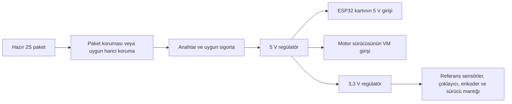

# Batarya, şarj ve güç dağıtımı — eşleştirme taslağı

Tarih: 22 Ekim 2026. Aşağıdaki ürünler fiyatı bulunan adaylardır; satın alınmadı ve birlikte denenmedi. Paket–şarj cihazı eşleşmesi için eksik üretici bilgileri tamamlanacak. Referans fiyatlar [bütçe taslağında](FIYATLI_BUTCE_TASLAGI.md).

## Önerilen parçalar ve kontrol durumu

| İşlev | Fiyat adayı | İncelenen bilgi / tamamlanacak kontrol |
| --- | --- | --- |
| Batarya | [Power-Xtra 7,4 V 2S1P 1000 mAh, satıcı 16322](https://www.direnc.net/74v-2s1p-1000-mah-15c-li-polymer-pil-soketli) | Satıcı Li-Polymer, 2S ve 1000 mAh bildiriyor. Koruma devresi, izin verilen şarj akımı ve dengeleme soketi henüz teyit edilmedi. |
| Dengelemeli şarj | [A3 2S/3S LiPo cihazı](https://www.robolinkmarket.com/a3-kompakt-lipo-2s-3s-sarj-aleti) | Satıcı 2S/3S LiPo kullanımını ve 700 mA / en çok 800 mA kanal akımı ifadelerini veriyor. Paketin bu şarj akımını kabul ettiği ve soket eşleşmesi doğrulanacak. |
| Harici koruma seçeneği | [2S 5A BMS, RLB0D03-6620](https://www.robolinkmarket.com/2s-5a-bms-batarya-yonetim-ve-koruma-modulu) | Paket koruması bulunmazsa değerlendirilecek. Hücre ara bağlantısı, gerçek akım/gerilim eşikleri ve pil kimyasıyla uyumu teyit edilecek. Paket korumalı gelirse ayrıca alınmayacak. |
| 5 V regülasyon | [FPV UBEC 5 V 3 A 2–6S](https://www.robolinkmarket.com/fpv-ubec-5v-3a-2-6s-dc-dc-voltaj-regulatoru) | Sayfada 2S–6S ve 5 V/3 A veriliyor. Sürekli çıkış akımı, ısıl koşullar ve pil gerilimi azaldığında regülasyon doğrulanacak. Bu, önceki incelemedeki stokta olmayan UBEC'den farklı üründür. |
| 3,3 V regülasyon | [AMS1117 modül, RLB2B07-0213](https://www.robolinkmarket.com/ams1117-33v-voltaj-regulator-modulu) | Satıcı 4,5–7 V giriş ve 3,3 V çıkış bildiriyor. Önerilen bağlantı 5 V dalındandır; toplam sensör/enkoder/mantık tüketimi ve ısıl durum kontrol edilecek. |

İki hücreli paket ile iki hücreli şarj cihazının aynı sınıfta olması ilk eşleştirmedir. Pilin üretici şarj şartları ve soketleri doğrulanmadan bu ikili kesin uyumlu sayılmayacak. A3 ürün sayfasındaki akım ifadeleri pilin izin verilen akımı olarak kullanılmayacak. BMS koruma işlevi içindir; şarj cihazının yerine geçmez.

## Ürün fotoğrafından çıkan ek kontrol

22 Ekim'de satıcının iki ürün fotoğrafı da incelendi. [Etiket fotoğrafında](https://www.direnc.net/74v-2s1p-1000-mah-15c-li-polymer-pil-soketli-2s-74v-lipo-piller-power-xtra-43457-16-B.jpg) PX1000XL, 1000 mAh, 15C ve “1S 3.7V*2” ibareleri; [soket fotoğrafında](https://www.direnc.net/74v-2s1p-1000-mah-15c-li-polymer-pil-soketli-2s-74v-lipo-piller-power-xtra-53197-16-B.jpg) dört konumlu soket ve dört iletken görülüyor. Bunlar satıcı fotoğrafı gözlemidir; satın alınacak ürünün pin şeması veya üretici veri sayfası değildir.

Satış sayfasındaki “2S1P/7,4 V” tanımıyla fotoğraftaki hücre/soket gösterimi üreticiden birlikte açıklatılacak. Hücrelerin paket içinde nasıl bağlandığı, pinlerin işlevi ve ayrı bir dengeleme çıkışı bulunup bulunmadığı fotoğraftan kesinleştirilemez. **A3 cihazına doğrudan takılabildiği kabul edilmeyecek.** Şarj akımı ve bağlantı belgesi alınamazsa, veri sayfası ve uygun şarj eşleşmesi belgelenen başka bir hazır paket seçilecek. Bu model değişikliği önerisidir; henüz yeni bir ürün seçilmedi.

## İşlevsel güç akışı önerisi

Bu şema işlevleri gösterir; pil/BMS/şarj cihazının pin bağlantı çizimi değildir. Şarj bağlantısı ürünlerin gerçek şemasına göre ayrıca belirlenecek. Devreler ortak GND referansı kullanacak; ana güç kabloları, konnektörler ve sigorta akım hesabına göre seçilecek. Sinyal jumper seti motor güç kablosu olarak bütçelenmedi.

Önceki yöntem önerisindeki gibi 6 V anma değerli motorların 5 V ile çalışması değerlendiriliyor. Üreticinin 6 V hız/tork değerleri 5 V için aynen kullanılmayacak. Motor yükü ve gerçek besleme davranışı test edilmeden başarı veya çalışma süresi yazılmayacak.

## Son seçimi tamamlayacak bilgiler

1. Paketin tam üretici kodu ve veri sayfası: şarj sonu gerilimi, izin verilen şarj/deşarj akımları ve çalışma sınırları.
2. Şarj cihazının gerçek çıkış akımı/profili, paketle dengeleme ve güç soketi eşleşmesi.
3. Paket içinde koruma olup olmadığı; harici koruma gerekiyorsa uygun hücre erişimi ve bağlantı şeması.
4. Normal düşük pil durdurma davranışı. BMS'nin sayfadaki geniş algılama aralıkları, doğrudan normal çalışma eşiği yapılmayacak.
5. 5 V ve 3,3 V dallarında toplam akım, gerilim düşümü ve ısıl kontrol; seçilen ESP32 kartında USB/programlama beslemesiyle güç yollarının düzenlenmesi.

Önceki erişim hatasının ardından [Power-Xtra ana sayfası](https://www.power-xtra.com/) 22 Ekim'de HTTP 200 ile açıldı. Ana sayfada bu paketin şarj sınırı/veri sayfası bulunmadı; ürünler için bağlantı verilen `www.birikimpilleri.net` adresinde ağ aracısı 403 döndürdü. Dolayısıyla üreticiye ait izin verilen şarj akımı hâlâ doğrulanmadı. [Teklif için gerekli bilgiler](TEKLIF_ICIN_GEREKEN_BILGILER.md), dört bağlantılı soket dahil eksik ürün bilgilerini ve Türkiye teslim fiyatlarını tamamlamak üzere hazırlandı; henüz satıcıya mesaj gönderilmedi.
